# CPS-2 Recomp

[](https://github.com/tmcleroy/cps2recomp/actions/workflows/ci.yml)
[](https://github.com/tmcleroy/cps2recomp/releases)
[](LICENSE)

**Unofficial native PC ports of Capcom's CPS-2 arcade games (and CPS-1 ones), for macOS, Linux (Steam Deck
and ARM64 included) and Windows, in one download with one launcher.** Each game's program is translated ahead of time into C++
and runs on a machine written for this project, not an emulator. Each fighting game has a training mode, which no release of these games has ever had; the beat-'em-ups take three players at once, with
free play, a stage to start at, a score attack and viewers for their stages and characters.

**[Get started: download it and play →](#playing)**

> **Beta.** Every game's code is checked instruction by instruction, and the fighting games play from start to
> ending (the beat-'em-ups, new, through their first stages in made-up play), but they have been played on few
> machines and controllers yet. Expect rough edges, and please
> [report what you find](#feedback-and-contributing).

**No game files are included.** You need your own copy of each game: its arcade ROM set (a CPS-2 game's with its key
file), from a board you own. **Only the version named below works for each game.** This project cannot help you get
one.

This project is not affiliated with, endorsed by, or sponsored by Capcom or Marvel. *Street Fighter*, *Super Puzzle
Fighter*, *Super Gem Fighter*, *Pocket Fighter*, *Vampire Savior*, *Vampire Hunter* and *Darkstalkers* are trademarks of Capcom Co., Ltd.; *X-Men*, *Marvel Super Heroes* and their
characters are trademarks of Marvel Characters, Inc.; *Alien vs. Predator*
and *Cadillacs and Dinosaurs* are trademarks of their owners; "CPS-1", "CPS-2" and "QSound" are names and trademarks of
their owners, used here only to say what the programs work with.

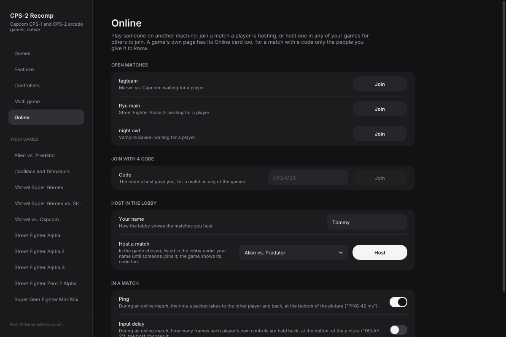

## The games

| Game | ROM set | What it adds |
| --- | --- | --- |
| [**Super Street Fighter II Turbo**](games/ssf2t/README.md) (1994, *Super Street Fighter II X* in Japan) | `ssf2xjr1` (Japan 940223, the tournament revision) | A full training mode (hit boxes, frame data and a frame meter, input display, combo and stun readouts, a dummy that records, replays and guards), widescreen, survival, ring out, endless battle, a tag team battle (the CPU tagging as a person would), the stage and model viewers, a zoom that follows either fighter or keeps both in the picture, Akuma and the old characters with no code, custom colours |
| [**Street Fighter Alpha**](games/sfa/README.md) (1995) | `sfa` (Europe 950727) | A full training mode (hit boxes, frame data and a frame meter, input display, combo and stun readouts, a dummy that records, replays and guards), widescreen, survival, ring out, endless battle, the stage and model viewers, a zoom that follows either fighter or keeps both in the picture, the hidden characters with no code, custom colours |
| [**Street Fighter Alpha 2**](games/sfa2/README.md) (1996) | `sfa2u` (USA 960430) | A full training mode (hit and throw boxes, frame data and a frame meter, combo, stun and Custom Combo readouts, input display, a dummy that records, replays, guards and answers), widescreen, survival, ring out, endless battle, a team battle, knock-out or Marvel-style tag (2 vs 2 for four players), the CPU tagging and playing a ring out for the ring, the stage and model viewers, a zoom that follows either fighter or keeps both in the picture, the hidden characters, custom colours |
| [**Street Fighter Zero 2 Alpha**](games/sfz2al/README.md) (1996) | `sfz2al` (Asia 960826, the revision played online) | Alpha 2's later revision, with the EX forms of Ryu, Ken, Sagat, M. Bison, Zangief and Dhalsim, Evil Ryu and the classic Chun-Li; everything Alpha 2's port has (its sources, checked against this game's code), all 28 characters in the model viewer and the colour editor |
| [**Street Fighter Alpha 3**](games/sfa3/README.md) (1998) | `sfa3u` (USA 980904, the tournament revision) | A full training mode (hit and throw boxes, frame data and a frame meter, combo, stun and custom combo readouts, fixed damage, input display, a dummy that guards high or low, Alpha counters, techs throws, rises quickly and mashes out of stun), widescreen, survival, ring out, endless battle, a team battle, knock-out or Marvel-style tag (2 vs 2 for four players), the stage and model viewers, a zoom that follows either fighter or keeps both in the picture, Balrog, Juni and Juli with no code, custom colours |
| [**Super Gem Fighter Mini Mix**](games/pocket_fighter/README.md) (1997, *Pocket Fighter*) | `sgemf` (USA 970904) | A full training mode (hit boxes, frame data and a frame meter, input display, combo and stun readouts, a dummy that records, replays and guards), widescreen, survival, ring out, endless battle, the stage and model viewers, a zoom that follows either fighter or keeps both in the picture, the hidden characters with no code, custom colours |
| [**Marvel Super Heroes**](games/msh/README.md) (1995) | `msh` (Europe 951024) | One-on-one with the Infinity Gems; a full training mode (hit boxes, frame data and a frame meter, input display, combo readout, a dummy that records, replays and guards, every gem at hand), widescreen, survival, ring out, endless battle, the stage and model viewers, a zoom that follows either fighter or keeps both in the picture, Dr. Doom and Thanos with no code, custom colours |
| [**X-Men vs. Street Fighter**](games/xmvsf/README.md) (1996) | `xmvsf` (Europe 961004) | The first tag-team game here, with tag-team co-op against the computer and 2 vs 2 for four players; a full training mode (hit boxes, frame data and a frame meter, input display, combo readout, a dummy that records, replays and guards), widescreen, survival, ring out, endless battle, the stage and model viewers, a zoom that follows either fighter or keeps both in the picture, the hidden character with no code, custom colours |
| [**Super Puzzle Fighter II Turbo**](games/puzzle_fighter/README.md) (1996) | `spf2t` (Europe 960529) | A training mode (attack readout, landing guide, input display, a dummy that sends counter gems to cancel, crash gems as you choose), CPU battle, the hidden characters at a kick, custom colours for the characters and the gems |
| [**Vampire Savior: The Lord of Vampire**](games/vampire_savior/README.md) (1997) | `vsavj` (Japan 970519) | A full training mode (hit boxes, frame data and a frame meter, input display, a dummy that records, replays and guards), widescreen, survival, ring out, endless battle, a tag team battle, knock-out or Marvel-style (the left trigger tags; 2 vs 2 for four players), the CPU tagging and playing a ring out for the ring, the stage and model viewers, a zoom that follows either fighter or keeps both in the picture, the hidden characters, custom colours |
| [**Vampire Savior 2: The Lord of Vampire**](games/vsav2/README.md) (1997) | `vsav2` (Japan 970913) | Donovan, Phobos and Pyron back, and Donovan's stage; everything Vampire Savior's port has (its sources, checked against this game's code) |
| [**Vampire Savior Definitive**](games/vsav_definitive/README.md) (beta) | `vsavj` and `vsav2` | Vampire Savior with Donovan, Phobos and Pyron taken from Vampire Savior 2, all eighteen by Vampire Savior's rules, the three with places of their own at the character choice; everything Vampire Savior's port has |
| [**Vampire Hunter 2: Darkstalkers Revenge**](games/vhunt2/README.md) (1997) | `vhunt2` (Japan 970929) | Night Warriors' cast on Vampire Savior's engine, each fighter's own theme; everything Vampire Savior's port has, and Dark Gallon among the hidden characters |
| [**Alien vs. Predator**](games/avsp/README.md) (1994) | `avspu` (USA 940520) | Three players at once (the board's own setting, on in Enhanced), free play, a round to start at, score attack, attract mode, the stage and model viewers, rapid fire, the board's settings, infinite health, lives and time |
| [**Cadillacs and Dinosaurs**](games/dino/README.md) (1993, CPS-1) | `dino` (World 930201) | The first CPS-1 game here, on a CPS-1 board written for it; three players at once, free play, a stage to start at, score attack, attract mode, the stage and model viewers, rapid fire, the board's settings, infinite health, lives and time |

| | | |
| --- | --- | --- |
| [](games/sfa2/README.md) | [](games/puzzle_fighter/README.md) | [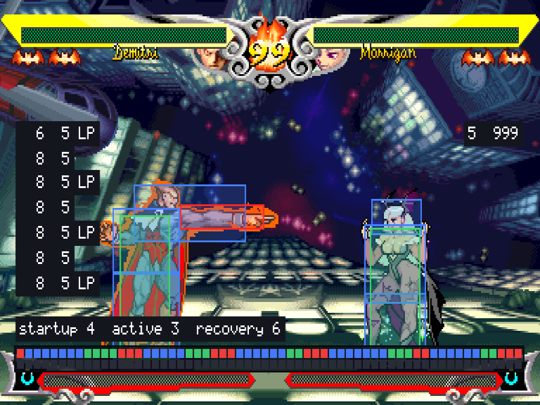](games/vampire_savior/README.md) |
| [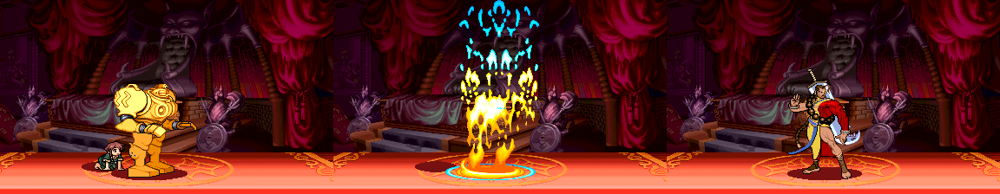](games/vsav2/README.md) | [](games/vhunt2/README.md) | [](games/vsav2/README.md) |
| [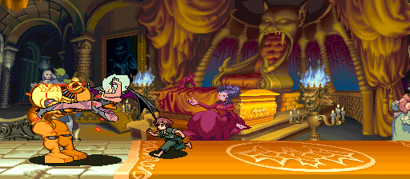](games/vsav_definitive/README.md) | [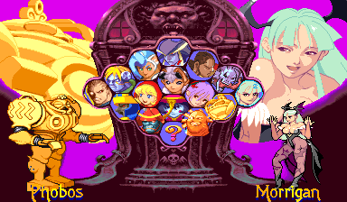](games/vsav_definitive/README.md) | [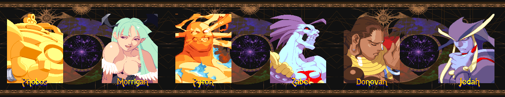](games/vsav_definitive/README.md) |
| [](games/avsp/README.md) | [](games/dino/README.md) | [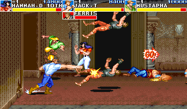](games/dino/README.md) |

Each game's page has all it does, with pictures.

## Every game has

- **Keyboard, gamepad or arcade stick**, with every key and button changeable, for each player, once for all
  the games or for one game on its own (the launcher's Controllers page: Layout for). A fighting game's controls
  also have all three punches at once and all three kicks, for a key or a button of their own.
- **An in-game menu** (Esc or `F1`; on a gamepad, the left stick's click or Start and Select together): the
  game's modes, save states, speed (from 1/8 to 8 times the board's, in 13 steps), pause and frame advance, cheats,
  every feature, and Reset all options (every feature back to the launcher's Enhanced preset).
- **Pure or Enhanced.** Pure plays exactly as the board does. Enhanced (the default) adds free play and your
  own colours. Every other feature is a switch of its own, off unless you choose it.
- **Rapid fire**: a button held down pressed again and again, fifteen times a second, for the first button or for
  all of them; the first press seen at once.
- **Arcade timing** (CPS-2 games): the processor run as on the arcade board, its waits for memory and the video chip's use of its
  bus counted, so the game slows down where and as much as the board does (big supers, busy screens). Off unless
  chosen; checked frame by frame against a cycle-exact model of the board ([docs/TIMING.md](docs/TIMING.md)).
- **Run-ahead**: what you press seen a frame or two sooner than on the board, with the game running exactly as
  without it.
- **The picture your way**: sharp, whole pixels or smooth; 4:3, square pixels or the whole screen; full screen
  or a window of the size you choose; widescreen in the fighting games.
- **Shaders**: the picture through one of RetroArch's shaders, by
  [librashader](https://github.com/SnowflakePowered/librashader): a curved CRT, CRT Lottes, CRT Royale, CRT Guest or
  a light CRT; scanlines light, strong, as an OSSC draws them, or dark; or xBRZ and ScaleFX to smooth the pixels'
  edges (the Display page's **Shader**). **Your own** takes any RetroArch slang preset (`.slangp`) you put in a
  `shaders` folder beside the game's settings, with the files it names (a few need a newer OpenGL than macOS has; Linux and Windows have it).
  Under Shader on the launcher's Features page, **In the game's menu** → **Choose** keeps the in-game menu's list to
  your favourites. Zoomed in, the camera closes in on the shaded picture, scanlines and all, as on a monitor. The menu is drawn over the picture without the shader. A shader that cannot be made leaves the
  picture as it was.

  | | | |
  | --- | --- | --- |
  | 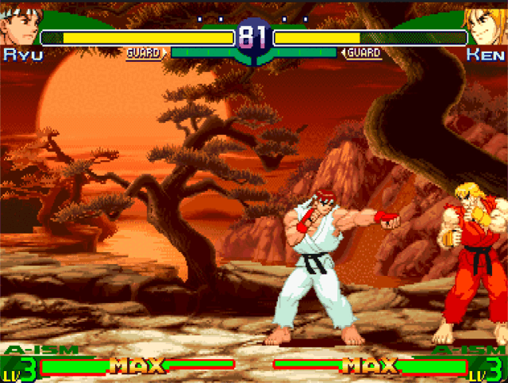<br>Off | 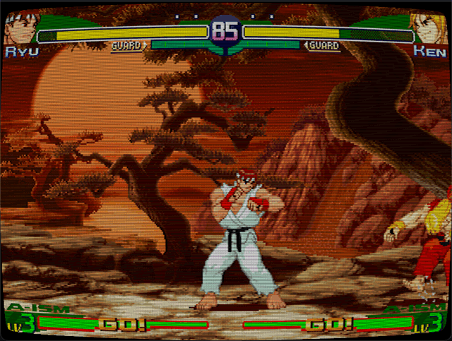<br>CRT | 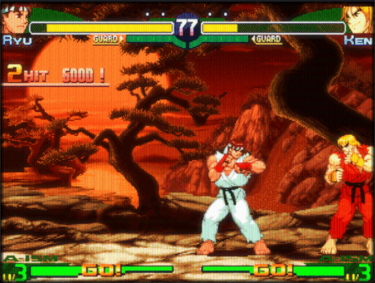<br>CRT Royale |
  | 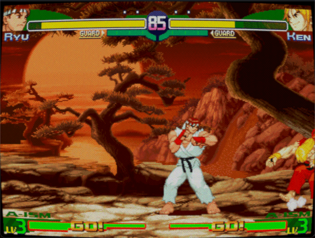<br>CRT Lottes | 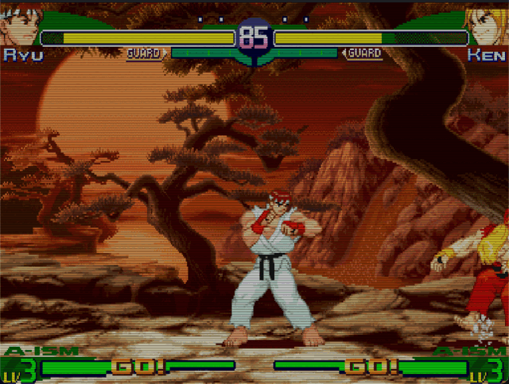<br>Scanlines, light | 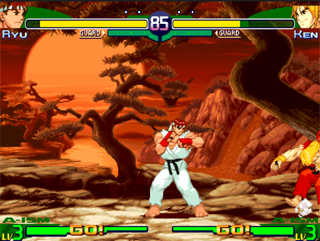<br>xBRZ |

- **Online play**: two players on two machines, over the internet or a home network, with rollback, so that each
  player's own controls answer at once whatever the distance. Host on a game's page and give the other player the
  code your game shows. [How →](#online-play)
- **The board's operator settings** (difficulty, damage, timer speed, game speed, rounds and the rest), each as
  the board is set unless you choose, and the game's own test menu.
- **Straight to the title**: at a start or a reset, everything before the title runs unseen.
- **A custom soundtrack**: your own music files (an arranged soundtrack from a console version, say) in place of
  the board's music, song by song, with the board's sound effects and voices. [How →](#a-custom-soundtrack)
- **Your ROM sets are only ever read.** Settings, save states and each board's settings memory go in your own
  user folder, or with the launcher, on a drive you carry, in [portable mode](#portable-mode).
- **Updates in the launcher**: new games and fixes come to the copy you have. When a new version is out the
  launcher says so at the top of its Games page, and **Update** downloads the new version, checks it, puts
  what changed in place and starts the new launcher. [More →](#updates)

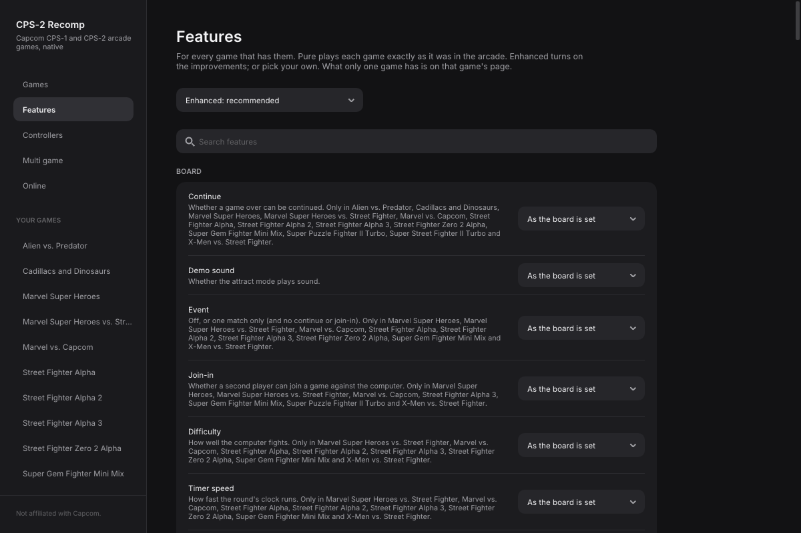

## Playing

1. Download the build for your system from the [releases page](https://github.com/tmcleroy/cps2recomp/releases)
   and unpack it. Each release's page has the steps for macOS, Windows, Linux and the Steam devices.
2. Open the launcher (`CPS-2 Recomp.app`, `cps2recomp-launcher`). On its Games page, **Choose folder…** and pick
   the folder you keep your ROM sets in: it finds each game's by the set's name (`ssf2xjr1.zip`, `sfa.zip`, `sfa2u.zip`, `sfz2al.zip`, `sfa3u.zip`,
   `sgemf.zip`, `msh.zip`, `xmvsf.zip`, `spf2t.zip`, `vsavj.zip`, `vsav2.zip`, `vhunt2.zip`, `avspu.zip`, `dino.zip`, or a folder of the set's files). Or drop a set, or the folder, on the window, or choose each
   game's set on its own. They stay where they are.
3. Press **Play** beside a game (the first of its two buttons, where a gamepad's ring lands). Several games can run at once, each in its own window.

Each game you have a ROM set for gets a page of its own in the sidebar: its Display switches (full screen,
widescreen), Play, and the features only it has. The **Features** page has what the games share (free play,
cheats, run-ahead, the picture, training mode's displays and the dummy, and the rest), set for every game at
once; a feature changed in a game's own menu is set for the others too when you leave the game. The
**Controllers** page sets the keys and buttons for all of them; its Layout for chooses a game, and Its own layout
gives that game keys and buttons apart from the others', under the game's own names for its buttons.

**Multi game** (the page after Controllers) plays several games one after another, for as long as you like. Its
**Endless battle** goes through every stage of a fighting game with the game playing both fighters, then on to the
next game's stages, and round again after the last: choose the games (every fighting game, or only some), their order
(the sidebar's, or shuffled), how the stages change (**Shuffle**, each fading into the next after the time you choose,
or **Scroll**, going by in order at the speed you choose), the **Screen** (every game full screen, every game in a
window, or as each game is set), the **Picture** (every game widescreen, every game 4:3, or as each game is set) and
the rest of the Display page every game has (**Invisible walls**, **Scaling**, **Picture shape**, **Window size**,
**Shader**, each also as each game is set) and the **Zoom** (**Both fighters**: in every game the camera follows the
two fighters, as close as they allow), then **Start**. These are for that run only: each game's own settings stay as they
were. In a window, each game opens where the one before it was and as large, wherever you moved it. Touch
the controls to take a fighter over. While it plays, **N** (or a gamepad's left shoulder) fades out to the next game
and **F** (or the left trigger) held fast-forwards at four times the speed; the page lists them under **While it
plays**. Quitting a game (its menu's Quit game, or closing its window) ends the run, as does **Stop after this
game**.

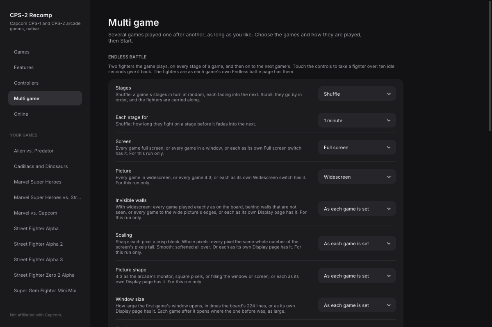

The games are in your order: drag a game's row in the sidebar up or down to keep the ones you play most at the top
(with a gamepad or the keyboard, **Move up** and **Move down** on its page, under Play). The Games page lists them
the same way. Playing only one or two of the games? Switch on **Only the games you have** on the Games page, and the
others are left out of it and of the Features and Controllers pages (**Choose folder…** still finds them). On a small screen, or with large text, the launcher closes up to fit: a narrower sidebar whose list
scrolls, and each row's buttons under its words.

While playing, Esc or `F1` (on a gamepad, the left stick's click, or Start and Select together) opens the
in-game menu. Only the menu's "Quit game" row (or closing the window) ends the game.

macOS: the app is not notarized, so the first time, right-click it and choose Open.
Linux: unpack the archive anywhere and run `cps2recomp-launcher`.
Windows: run `cps2recomp-launcher.exe`. Opening a game's own program (`sfa2.exe`, say) starts the launcher too,
at that game's page (or straight into the game once its ROM set has been chosen).

### Updates

When the launcher opens it asks GitHub for this project's releases (the Updates card, at the top of the Games
page, has a switch to stop that, and **Check now**). When there is a newer version it shows at the top of the Games page: **What's new**
opens its notes, and **Update** downloads the new version's download for your system (the same file as on the
releases page), checks it and every file that changed against the release's list, and only then
puts them all in place; if anything goes wrong nothing is changed. The launcher then starts again as the new
version. Your settings, save states and ROM sets are not touched. Quit the games first: Update waits until none is
running. A beta is offered only to a beta.

The launcher needs to be able to write to its own folder: on macOS, move `CPS-2 Recomp.app` to Applications (or
anywhere of your own) before opening it the first time, not run it from the downloaded zip's folder. A copy built
from source is told of a new version but not changed.

### Portable mode

To keep everything with the launcher (on a USB stick or an external drive you take from one computer to another),
put an empty file named `portable.txt` beside it:

| System | Where `portable.txt` goes | Where your things then are |
| --- | --- | --- |
| Windows, Linux, Steam Deck | in the `CPS2Recomp` folder, beside `cps2recomp-launcher` | `CPS2Recomp/user/` |
| macOS | in the folder `CPS-2 Recomp.app` is in (not inside the app) | `user/` in that folder |

Settings, save states, each board's settings memory, custom colours, the score attack records, a soundtrack in
the game's own folder and the logs then go in `user/`, a folder for the launcher and one for each game, laid out
as in your user folder. The launcher's Games page shows where they are under **Your files** (**Show** opens the
folder).

- **The first time**, if your user folder already has the games' things, the launcher asks whether to copy them
  to `user/`. Copying never takes anything from your user folder and never writes over a file.
- **To stop**, take `portable.txt` away: the launcher uses your user folder again, as it was when you started
  portable mode. Nothing is moved either way; to carry things back, copy the folders in `user/` to your user
  folder yourself (with the launcher closed).
- **Updates** keep `portable.txt` and `user/`: they change only the release's own files.
- **The folder has to be one you can write to.** If it is not (a read-only drive, or Windows' Program Files), the
  launcher says so and stops rather than keep your things somewhere else.
- ROM sets are still only read, wherever they are. A ROM folder chosen on a drive letter (Windows) or a mount
  point (`/Volumes/...`, `/media/...`) is remembered as that path: on another computer, choose it again if the
  drive is somewhere else. A Steam shortcut (**Add to Steam**) is for the computer it was added on.

### From a terminal

```sh
cps2recomp-launcher --play sfa2                 # straight into a game, as the launcher has it set
cps2recomp-launcher --play sfa2 -- --features widescreen,no_damage
                                                # with more arguments for the game, after the launcher's own
cps2recomp-launcher --page vampire_savior       # the launcher, at a game's page
sfa2 --rom ~/roms/sfa2u.zip --settings my.ini   # a game's own program (beside the launcher), by itself
sfa2 --soundtrack ~/music/sfa2-arranged          # a custom soundtrack's folder (with the feature on)
sfa2 --help                                     # what a game's program takes
```

The games' ids are `ssf2t`, `sfa`, `sfa2`, `sfz2al`, `sfa3`, `pocket_fighter`, `msh`, `xmvsf`, `puzzle_fighter`, `vampire_savior`, `vsav2`, `vhunt2`, `vsav_definitive`, `avsp` and `dino`. `--features` may be given more than once, and
a later one wins.

### Online play

Two players, each on their own machine (macOS, Linux, the Steam Deck or Windows, in any mix), each with the game and
its ROM set. On the game's page in the launcher, under Play, the **Online** card has **Host** and **Join**. The host
presses Host, and their game shows a **match code** (`K7Q-M2X`); the other player types it into Join. Nothing needs
setting up on either router. The host is player 1. The game's window says it is waiting until the other player comes
(Esc gives up). From a terminal:

```sh
cps2recomp-launcher --play sfa3 -- --host                  # the host: shows a code, waits for the other player
cps2recomp-launcher --play sfa3 -- --join K7Q-M2X          # the other player: the host's code (or address)
```

- **Join with a code** on the launcher's Online page: type a code a host gave you, for a match in any of the games,
  and press Join: the launcher starts the game the match is in.
- **The lobby** (opt-in): switch on **List my matches in the lobby** on the Online card and give **Your name**, and the
  matches you host are listed under **Open matches** on every other player's card for that game, until someone joins;
  they press Join. Matches not listed are joined only with their code.
- **The Online page** in the launcher's sidebar shows every game's open matches at once, each with Join, and hosts a
  match in the lobby in whichever of your games you choose. A match in a game whose ROM set you haven't added is shown
  greyed, with **Add…** to go and add it.
- **How the code works**: a small service of ours introduces the two games, telling each where the other can be
  reached, and they then connect straight to each other through their routers; none of the match goes through it
  ([online/README.md](online/README.md)). A code lasts 30 minutes and is good for one match.
- **Joining by address** works too, without the service: on a home network, the host's own address (the Online card
  lists it); over the internet, the host's public address with UDP port 7845 forwarded to it on the router (`--host
  7900` and `--join ADDRESS:7900` for another port); or a VPN such as [Tailscale](https://tailscale.com). That is
  also the way for the rare two networks a code can't connect (some mobile networks).
- **Each player presses Start to come in**, as at the arcade: the first to press plays the computer until the other
  presses theirs ("Here comes a new challenger").
- **Each player plays with their own player 1 controls**, and hears and sees the game as their own settings have it
  (the Display page, the shader, the zoom, the custom soundtrack). The match takes the host's board settings
  (difficulty, timer, rounds...) and the host's features that change play (free play, arcade timing,
  widescreen, hidden characters...), for the match only: the other player's own are left as they are.
- **Rollback**: each side runs the game with both players' controls, its own player's held back 2 frames (as a
  board's game might be; `--net-delay N` on the host, 0 to 8), and the other player's guessed until they come. When
  a guess was wrong, the game goes back to that frame and runs on again with the real ones, unseen and unheard, in
  the time of one frame. Up to 8 frames are guessed; past that the game waits for the other side.
- **The two games are checked against each other**: every second each side sends the other a fingerprint of the
  game; if they ever differ, the match stops and says so (a desync, which should not happen).
- **The ping** is said at the bottom of the screen all through a match ("PING 42 ms"), and the input delay too if you
  like ("DELAY 2"): each is a switch, **Ping** (on) and **Input delay**, on the Online page under In a match (and on the
  Features page).
  "WAITING FOR THE OTHER PLAYER" shows if their game goes quiet for a moment, and **PRESS START TO JOIN** until you
  have.
- **Coming back after a drop**: if the other player's game closes or their connection drops, the host's game stays
  open and waits for them with the same code; a joining player whose connection dropped is taken back to the host by
  itself. The two games then start over together from the title. (The host closing their game ends the match.)
- **Win streaks**: in the fighting games, a player who wins two or more matches in a row against the other has it
  said under their life bar ("STREAK 3"), counted from when both have pressed Start, until the streak ends.
- **Leaving a match**: Esc, or the gamepad's menu button, asks **Leave the match?** over the game (which goes on);
  Confirm leaves, Back stays.
- **Off during a match**: the cheats (on both sides, for a fair match), the in-game menu, save states, pause, the speed, run-ahead, the training mode and the
  other modes (endless battle, tag team, the viewers). A match ends when either player closes their game.

### A custom soundtrack

Each game can play your own music files in place of the board's music: an arranged soundtrack, say. The sound
effects and voices stay the board's.

1. Switch on **Custom soundtrack** (the Features page, under Sound; it is on in Enhanced, off in Pure).
2. On a game's page, under Sound, **Choose…** the folder your music files are in (`.ogg`, `.flac`, `.mp3` or
   `.wav`). With none chosen, the game uses the `soundtrack` folder in its own settings folder
   (`~/Library/Application Support/<Game>/` on macOS, `~/.local/share/<Game>/` on Linux and Steam Deck,
   `%APPDATA%\<Game>\` on Windows, `user/<Game>/` beside the launcher in [portable mode](#portable-mode)), which
   it makes.

That is all it takes: **a folder of music plays as a playlist**, in place of all the game's music, one file after
another in their names' order (`2 ...` before `10 ...`), and from the first again after the last. Choose **On,
shuffled** for a random order.

**To replace particular songs** instead, name each file after the piece of music it replaces: `ryu.flac`,
`player_select.ogg`, `ken_ending.mp3`. The game writes `songs.txt` into the folder, with every piece of its music
by name and number and what it is (Street Fighter Alpha 2 has 59: each character's theme, each ending, the staff
rolls, the title and the screens between fights). Once one file is named for a song, the folder works this way: a
song you have no file for plays as the board has it, and other files are left alone.

For files with other names, loops and loudness, put `soundtrack.ini` in the folder:

```ini
volume = 80                  ; every song, in percent

[ryu]                        ; a song by its name (or its number: [01])
file = 05 Ryu's Theme.flac
loop = 0:12.5 - 2:47.25      ; the part that repeats: start - end (minutes:seconds, or seconds)
volume = 90
```

A song's file repeats whole unless it says otherwise: by `loop` in `soundtrack.ini`, `loop = no` to play it once, or the
loop tags many soundtrack packs have (`LOOPSTART`, with `LOOPEND` or `LOOPLENGTH`, in samples). The music the board
plays once (a fanfare, the versus screen, a game over) is played once. The music keeps the game's time: pausing,
the menu, slow motion, a save state and run-ahead leave it where the game is (a playlist plays on, and waits only
while the game is held). The game plays exactly the same with
or without it.

No music is included, and this project can't help you get any: use files you made from discs you own.

### Coming from a game's own download

Earlier releases came one game at a time (Street Fighter Alpha 2 Recomp, Vampire Savior Recomp). This launcher
keeps each game's settings, save states and board memory in the same folder as before, and takes the ROM set you
chose in a game's own launcher, so everything carries on. A game's own release still works.

### Steam Deck

1. Hold the power button and choose **Switch to Desktop**.
2. Download `CPS2Recomp-linux-x86_64.tar.gz` from the [releases page](https://github.com/tmcleroy/cps2recomp/releases).
   In the file manager (Dolphin), right-click it and choose **Extract → Extract archive here**, then move the
   `CPS2Recomp` folder where it can stay (for example a new `Applications` folder in your home folder). If you
   move it later, do step 5 again.
3. Copy your ROM sets onto the Deck into one folder, for example from a USB stick or the SD card.
4. In the `CPS2Recomp` folder, open `cps2recomp-launcher`; on its Games page, **Choose folder…** and pick that
   folder.
5. On each game's page, press **Add to Steam**. It adds the game to your library (straight into it), and the
   first time also **CPS-2 Recomp** (the launcher: ROM sets, features and controls).
6. Go back to Gaming Mode with the **Return to Gaming Mode** icon on the desktop. They are in your Library under
   **Non-Steam**.

In a game, click the left stick, or press View and Menu together (the two buttons either side of the screen's
top), to open the in-game menu; its "Quit game" row ends the game.

## What you need

- The ROM set of each game you want to play (a CPS-2 game's with its key file): `ssf2xjr1` (*Super Street Fighter II
  X: Grand Master Challenge*, Japan 940223), `sfa` (*Street Fighter Alpha: Warriors' Dreams*, Europe 950727), `sfa2u` (*Street Fighter Alpha 2*, USA 960430), `sfz2al` (*Street Fighter Zero 2 Alpha*, Asia 960826), `sfa3u` (*Street Fighter Alpha 3*, USA 980904),
  `sgemf` (*Super Gem Fighter: Mini Mix*, USA 970904), `msh` (*Marvel Super Heroes*, Europe 951024), `xmvsf` (*X-Men Vs. Street Fighter*, Europe 961004), `spf2t` (*Super Puzzle Fighter II Turbo*, Europe 960529), `vsavj` (*Vampire Savior: The Lord of Vampire*,
  Japan 970519), `vsav2` (*Vampire Savior 2: The Lord of Vampire*, Japan 970913), `vhunt2` (*Vampire Hunter 2:
  Darkstalkers Revenge*, Japan 970929), `avspu` (*Alien vs. Predator*, USA 940520), `dino` (*Cadillacs and Dinosaurs*,
  World 930201). Vampire Savior Definitive needs both `vsavj` and `vsav2`. As a zip (with its parent set's zip beside it if your collection keeps the shared files there)
  or a folder of the set's files. The launcher checks every file by checksum and tells you which is missing or
  different. Sets of other regions and revisions are refused: each port is made from that one version's
  program, and its features use addresses found in it.
- One of: macOS 13 or later (Apple silicon or Intel); Linux x86_64 or SteamOS; Linux ARM64 (aarch64); Windows 10 or
  11, 64-bit.
- A gamepad or stick (six buttons for the fighting games) is recommended; for three players in the beat-'em-ups, three
  gamepads (or keys chosen for each player).

## How it works

Each game's 68000 program is translated ahead of time into C++ and compiled into that game's program, and the
parts its features touch are rewritten by hand as readable C++, each checked call by call against the game's
own code. What the program expects of the board (its video, the QSound chip, the sound CPU and its registers,
the settings memory) is code written for this project, not an emulator. The [toolkit](docs/TOOLKIT.md) is shared
by every game, so a fix or a feature there reaches all of them; each game's page says how its port works. Games
Capcom made from another's program (Vampire Savior 2 and Vampire Hunter 2, from Vampire Savior's) build that game's
sources, with a list of where each place they name is in the other game, so they have all of its features. Vampire
Savior Definitive runs Vampire Savior 2's own code for the characters it takes from it, beside Vampire Savior's, with
that game's pictures and sound ([how and why](games/vsav_definitive/DEFINITIVE.md)).

## Building from source

With your own ROM sets in `rom/<id>/` (ignored by Git), CMake, Ninja, SDL 3 and Python 3:

```sh
make GAME=sfa2              # twice the first time
make GAME=sfa2 explore      # once, about ten minutes: finds the game's code by made-up play and translates it
make collection             # every game whose ROM set is here, and the launcher for all of them
```

[docs/BUILDING.md](docs/BUILDING.md) has every platform, the checks and the release builds, and
[docs/TOOLKIT.md](docs/TOOLKIT.md) how the toolkit works and how a game is added. `make check` needs no game.

## Feedback and contributing

Bug reports and pull requests are welcome: see [CONTRIBUTING.md](CONTRIBUTING.md) for the rules (above all:
nothing from any game, ever, and never a key) and each game's roadmap for what is next. Security reports go by
[SECURITY.md](SECURITY.md).

## Related projects

| Project | What |
| --- | --- |
| [satrecomp](https://github.com/tmcleroy/satrecomp) | The same kind of toolkit for Sega Saturn games |
| [recomp-common](https://github.com/tmcleroy/recomp-common) | The in-game menu, settings rules and launcher this project and satrecomp share |
| [Muscle March Recomp](https://github.com/tmcleroy/muscle-march-recomp) | A native port of *Muscle March* (WiiWare), by the same author |
| [doaxvb-re](https://github.com/NoRain211/doaxvb-re) | A native Windows port of *Dead or Alive Xtreme Beach Volleyball* (Xbox), by NoRain211; not made with these toolkits |

## License and credits

[GPL-3.0-only](LICENSE). [THIRD_PARTY_NOTICES.md](THIRD_PARTY_NOTICES.md) has the notices in full.

- The program cipher (`machine/cps2crypt.*`) is MAME's (BSD-3-Clause; its header says so), worked out by
  Andreas Naive and Nicola Salmoria. The QSound model follows MAME's high-level one (superctr, Valley Bell), and
  the hardware facts follow MAME's CPS-2 and CPS-1 drivers. The Kabuki cipher of the CPS-1's sound CPU
  (`machine/kabuki.*`) is written from the facts MAME's `kabuki.cpp` publishes (Nicola Salmoria); its keys are not
  here: the port works each out from the player's own ROM.
- The launcher's look, and the files that make it, come from the launcher of
  [wiiparty-recomp](https://github.com/arelkair/wiiparty-recomp) by arelkair (GPL-3.0-or-later). They are in
  `recomp-common/launcher/`, with the notices in recomp-common's `THIRD_PARTY_NOTICES.md`.
- The programs use SDL 3 (zlib license), Dear ImGui (MIT) and the Inter font (SIL OFL 1.1, compiled into the
  launcher); the release archives carry their licenses.

The repository holds no game data and nothing derived from it.
