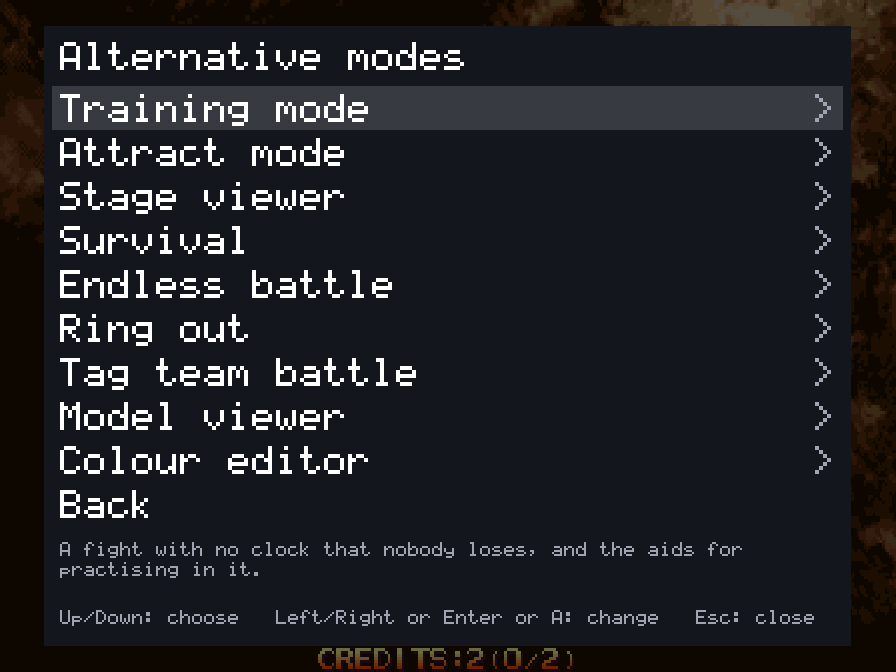
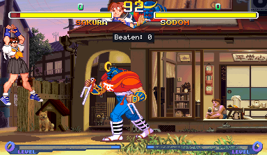
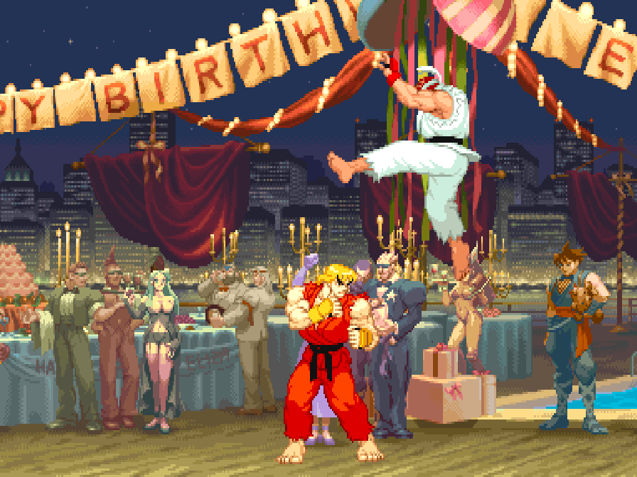
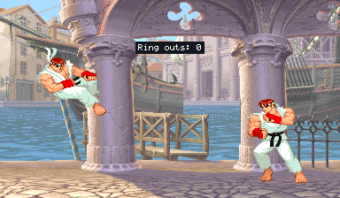
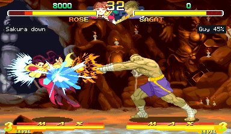
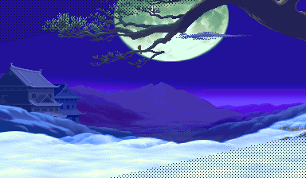
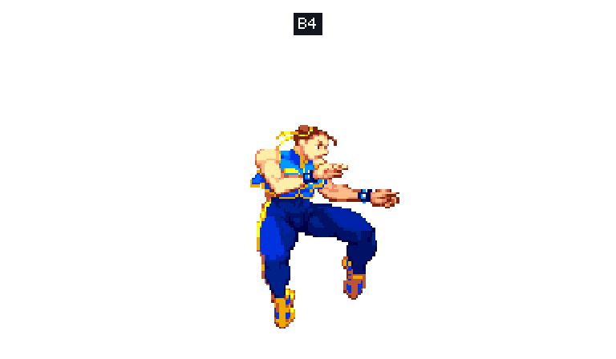
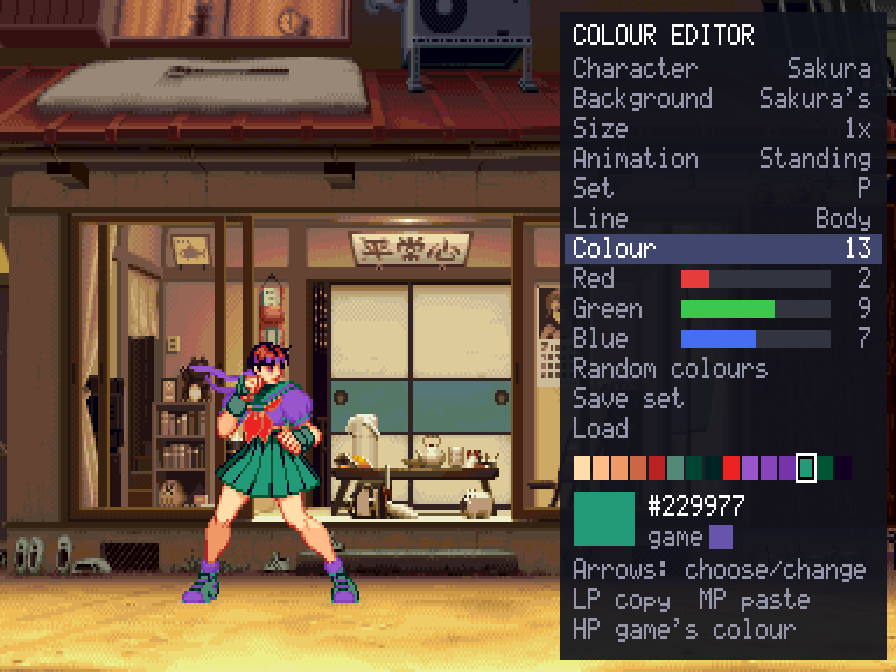

# Alternative modes and Multi game

## Alternative modes

The in-game menu's first row, **Alternative modes**, has ways of playing and watching a fighting game that the
board doesn't have. Each has a page with a Start row and its own choices, and runs until another is started or the
menu's Reset game. Which modes a game has is on its own page.

### Training mode

A fight with no clock that nobody loses, and the training aids: [training mode](TRAINING.md).

### Survival

One computer opponent after another on the health you have left. How many can you beat?

### Endless battle

Two fighters the game plays, for as long as you like, with no bars and no clock: on one stage, on stages that fade
one into another, or on a floor that scrolls through them all. Touch the controls to take a fighter over.

### Ring out

No health. Knock your opponent off the end of the stage, then jump down after them and land on the next stage. The
computer plays it as a ring out too.

### Tag team battle

In every fighting game but Alpha, Pocket Fighter and Marvel Super Heroes. Two teams of two or three. In the
knock-out style one fighter of each team is on at a time, and the next comes on at a knock-down. In the tag style
(Marvel-style) you tag the next one in with the left trigger, and resting fighters get some health back. Play
co-op against the computer's team, or 2 vs 2 for four players.

### Stage viewer

Any stage with nobody on it, scrolled with the stick or by itself, with any tune.

### Model viewer

One character by itself at any size, on a stage or on plain white or black, moved with your controls or going through
its animations.

### Colour editor

Change a character's colours while you watch, and keep them for that character.

### Attract mode

The game's own show on a loop: everything, the introduction only, or one demonstration fight after another.

### The beat-'em-ups

Alien vs. Predator and Cadillacs and Dinosaurs have their own modes: three players at once, a stage to start at, a
score attack, and the stage and model viewers.

## Multi game

**Multi game** (the page after Controllers) plays several games one after another, for as long as you like. Its
**Endless battle** goes through every stage of a fighting game with the game playing both fighters, then on to the
next game's stages, and round again after the last: choose the games (every fighting game, or only some), their order
(the sidebar's, or shuffled), how the stages change (**Shuffle**, each fading into the next after the time you choose,
or **Scroll**, going by in order at the speed you choose), the **Screen** (every game full screen, every game in a
window, or as each game is set), the **Picture** (every game widescreen, every game 4:3, or as each game is set) and
the rest of the Display page every game has (**Invisible walls**, **Scaling**, **Picture shape**, **Window size**,
**Shader**, each also as each game is set) and the **Zoom** (**Both fighters**: in every game the camera follows the
two fighters, as close as they allow), then **Start**. These are for that run only: each game's own settings stay as they
were. In a window, each game opens where the one before it was and as large, wherever you moved it. Touch
the controls to take a fighter over. While it plays, **N** (or a gamepad's left shoulder) fades out to the next game
and **F** (or the left trigger) held fast-forwards at four times the speed; the page lists them under **While it
plays**. Quitting a game (its menu's Quit game, or closing its window) ends the run, as does **Stop after this
game**.

