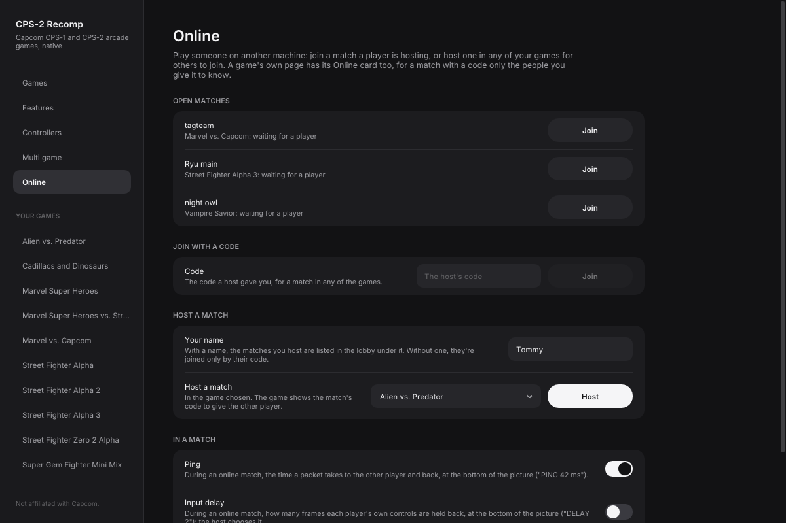

# Online play

Two players, each on their own machine, play a match with **rollback** netcode. Any mix of macOS, Linux, the Steam
Deck and Windows can play each other.



## Starting a match

Each player needs the game and its ROM set. The launcher's **Online** page (in the sidebar) has it all:

- **Online matches**: the matches other players are hosting in the lobby, in every game, each with **Join** (or
  **Watch**, for one under way: [watching a match](#watching-a-match)). A match in a
  game whose ROM set you haven't added is greyed, with **Add…** to add it.
- **Join with a code**: type the code a host gave you and press **Join**. The launcher starts the game the match is in.
- **Host a match**: choose a game and press **Host**. The game shows the match's code to give the other player. If
  you've set **Your name**, the match is also listed in the lobby under it until someone joins; without a name, only
  those you give the code to can join.
- **Waiting room**: the other players whose Online page is open now, under their names. Choose a game and press
  **Invite** next to someone: your game starts and hosts a match, and they see the invitation on their Online page,
  naming you and the game, with **Accept** and **Decline** (and **Add…** if they haven't that game's ROM set). Accept
  starts their game and joins yours; your game's wait says if they declined. You're in the waiting room while your
  Online page is open and you've set **Your name**, unless you switch off **Let others invite me**. An invitation never
  interrupts a game: it waits on the Online page. **Block** (on a player or an invitation) hides the two of you from
  each other; **Unblock all** undoes it. Nobody's address is shown, only names.
- **Host from the game**: playing a game on your own, open its menu (Esc), go to **Online** and choose **Host a
  match**. Your game stays exactly your own while you wait: modes, training, cheats, the menu, save states, pause. The
  bottom of the screen says HOSTING with the match's code, and with a name set on the launcher's Online page the match
  is in the lobby too. When someone joins, the game starts over from the title for the match, with the match's
  settings. After the match you're back to your own settings and still hosting with the same code (unless you left
  the match yourself). The menu's row, now **Stop hosting**, stops it.
- **Arcade while waiting** (a switch under Host a match): play the game on your own while you wait, as at the arcade.
  The match's code and "WAITING FOR A CHALLENGER" show at the bottom of the screen. When someone joins, they come
  into your game as it is and press Start to challenge you. Esc asks whether to stop hosting.

Both players need the **same version** of CPS-2 Recomp; the launcher shows its version at the top of the sidebar.
A match on another version is greyed in Online matches, and a code for one says so. Your ROM sets can be different
regions of the same game (`mvscj` against `mvsc`, say): the match is played as the host's region. That is best
effort: if the game reads a part of its program where the two sets still differ, the match stops as a desync does
(the same set is surest).

Each game's own page has the same under Play, in its **Online** card. Nothing needs setting up on either router. The
host is player 1. The game's window says it is waiting until the other player comes (Esc gives up). From a terminal:

```sh
cps2recomp-launcher --play sfa3 -- --host                  # the host: shows a code, waits for the other player
cps2recomp-launcher --play sfa3 -- --host --net-arcade     # ... playing the game meanwhile
cps2recomp-launcher --play sfa3 -- --join CODE             # the other player: the host's code (or address)
```

## Watching a match

A host who switches on **Allow spectators** (on the launcher's Online page, off unless chosen) lets others watch. Once
the match is under way, its lobby entry says **Match in progress** and offers **Watch** in place of Join. A viewer needs
the game, a ROM set and the same version as the players, and can come in at any point: the game shows **SPECTATING**,
a moment behind the players, from the host's game as both players' controls have it. An FT5 or FT10 set's score
comes along too.

A viewer's controls and chat never reach the match, and the players never wait for a viewer. Up to eight can watch; one
who falls too far behind is let go and can choose Watch again. Esc asks **Stop watching?**; leaving changes nothing for
the players. A match that isn't in the lobby can't be watched by code. From a terminal: `--net-spectators` when hosting,
`--watch CODE` to watch (or `--watch ADDRESS:PORT`, with `--net-service off`, on the same network).

## Ball battle and tag team online

In a fighting game that has them, the host can switch the match to **Ball battle** or the **Tag team battle** and back
to **Versus**, at any time: Esc (or the gamepad's menu button) shows **Play: < Ball battle >**; Left and Right choose,
Confirm starts it. Both players choose their own fighters on the same overlay (**Ball battle: your fighter**, **Tag
team: your first**, second, third): the host for player 1's side, the other player for player 2's, Random or anyone.
What each player picks, and what the host starts, is said on both screens. The rest of each mode's page (first to how
many, the stage, the team's size and style...) is the host's, as the host had it before the match; online, both sides
are always people (never the CPU), and the stage is one of the game's own. A joining player's own picks for player 2's
side (the modes' pages, before joining) come with them. **Versus** ends the mode: the board starts again, and each
player presses Start to come back in.

How it works (`port/netplay.h`, Netplay::Command): a choice is an event of that player's, sent with their controls for
the frame it is for (again until the other side has them), so that it never comes without them; both sides run it
before that frame, player 1's first, and a side that has run past it on guessed controls goes back to it, as for a
wrong guess. Its seed makes the mode's choices at random the same on both sides (battle::StartOnline). Everything the
modes keep from frame to frame is in the save state the rollback puts back (the court's sources' `Description::state`,
the games' live tag). Not yet: viewers (their playback stops when the host switches mode), ring out and the endless
battle (they run more than one copy of the game), other games' stages, and four players in a tag team.

`--net-command FRAME:TEXT` (tests) makes an event at that frame: `mode=1:7` the ball battle with seed 7, `mode=2:7` the
tag team battle, `mode=0:1` Versus, `court_one=3` (the host) or `court_two=3` (the other player) a fighter.

## First to five or ten

Marvel vs. Capcom and X-Men vs. Street Fighter have **Online > Set format**: **Casual** (the default, and in Pure),
**FT5** or **FT10**. The host's choice is the match's, as with its other settings.

A strip at the top shows both names around the score (`2 FT5 1`). A game counts when one player wins it from the other:
not a draw, not a fight with the computer, and only once both games have the real controls for it (a guess that a
rollback replaced never counts). When a player reaches five (or ten), both games agree on the score, show the winner
for two seconds and close, back to the launcher; host again there for a new set. A dropped connection ends the set
unfinished, and coming back starts the score over. Nothing is kept or ranked.

From a terminal, `--features online_set=1` is FT5 and `online_set=2` FT10, on the host:

```sh
build/mvsc/mvsc --rom rom/mvsc --host 7845 --net-service off --features online_set=1
build/mvsc/mvsc --rom rom/mvsc --join 127.0.0.1:7845 --net-service off   # (the other player)
```

## How it connects

- **How the code works**: a small service of ours introduces the two games, telling each where the other can be
  reached, and they then connect straight to each other through their routers; none of the match goes through it
  ([online/README.md](../online/README.md)). A code lasts 30 minutes and is good for one match.
- **Joining by address** works too, without the service: on a home network, the host's own address (the Online card
  lists it); over the internet, the host's public address with UDP port 7845 forwarded to it on the router (`--host
  7900` and `--join ADDRESS:7900` for another port); or a VPN such as [Tailscale](https://tailscale.com). That is
  also the way for the rare two networks a code can't connect (some mobile networks).

## In a match

- **Each player presses Start to come in**, as at the arcade: the first to press plays the computer until the other
  presses theirs ("Here comes a new challenger").
- **Each player plays with their own player 1 controls**, and hears and sees the game as their own settings have it
  (the Display page, the shader, the custom soundtrack). There's no zoom online: both see the whole picture, as the
  board shows it. The match takes the host's board settings
  (difficulty, timer, rounds, the Marvel games' game speed and turbo...) and the host's features that change play (free
  play, arcade timing, widescreen, hidden characters...), for the match only: the other player's own are left as they
  are. The host chooses them before hosting (the launcher's pages, or the in-game menu before choosing Host); during
  the match the in-game menu shows them as the match has them and doesn't change them.
- **Rollback**: each side runs the game with both players' controls, its own player's held back 2 frames (as a
  board's game might be; `--net-delay N` on the host, 0 to 8), and the other player's guessed until they come. When
  a guess was wrong, the game goes back to that frame and runs on again with the real ones, unseen and unheard, in
  the time of one frame. Up to 8 frames are guessed; past that the game waits for the other side.
- **The two games are checked against each other**: every second each side sends the other a fingerprint of the
  game; if they ever differ, the match stops and says so (a desync, which should not happen).
- **The ping** is said at the bottom of the screen all through a match ("PING 42 ms"), and the input delay too if you
  like ("DELAY 2"): each is a switch, **Ping** (on) and **Input delay**, on the Online page under In a match (and on the
  Features page).
  "WAITING FOR THE OTHER PLAYER" shows if their game goes quiet for a moment, and **PRESS START TO JOIN** until you
  have.
- **Coming back after a drop**: if the other player's game closes or their connection drops, the host's game stays
  open and waits for them with the same code; a joining player whose connection dropped is taken back to the host by
  itself. The two games then start over together from the title. (The host closing their game ends the match.)
- **Win streaks**: in the fighting games, a player who wins two or more matches in a row against the other has it
  said under their life bar ("STREAK 3"), counted from when both have pressed Start, until the streak ends.
- **Names**: each player's name, as set on the launcher's Online page, is under their life bar (Hide names, on the
  Online page, hides them).
- **Chat**: press T on the keyboard, a gamepad's right stick click, or the touch screen's Chat button, type a line and
  press Enter (Esc, or the click again, puts it away). The Steam Deck and phones show their own on-screen keyboard.
  The last few lines show at the bottom left for a few seconds, and under them how to chat (as a match begins) and
  how to send or put away the line you're typing. Chat goes straight from one game to the other, as the
  controls do: nothing of it passes through our service. While you type, the keyboard is the chat's, so a keyboard
  player's fighter stands still; a gamepad still plays.
- **Leaving a match**: Esc, or the gamepad's menu button, asks **Leave the match?** over the game (which goes on);
  Confirm leaves, Back stays.
- **Off during a match**: the cheats (on both sides, for a fair match), the in-game menu, save states, pause, the speed, run-ahead, the training mode and the
  other modes (endless battle, ring out, the viewers); Ball battle and the tag team battle the host starts from Esc's
  overlay (above). A match ends when either player closes their game.
