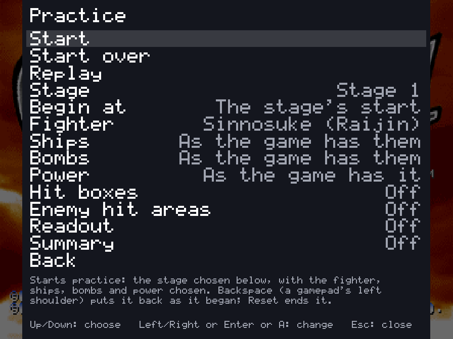
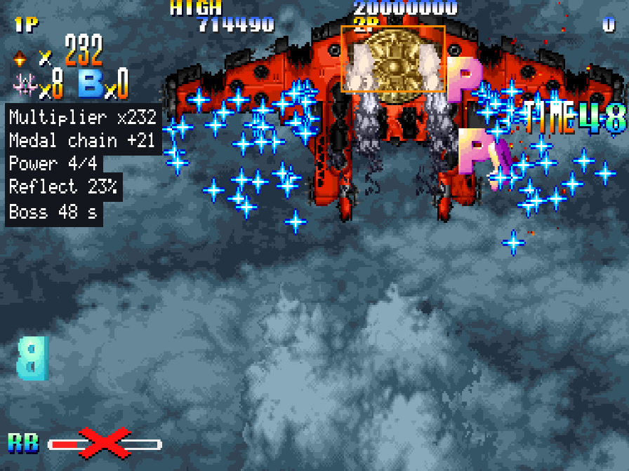
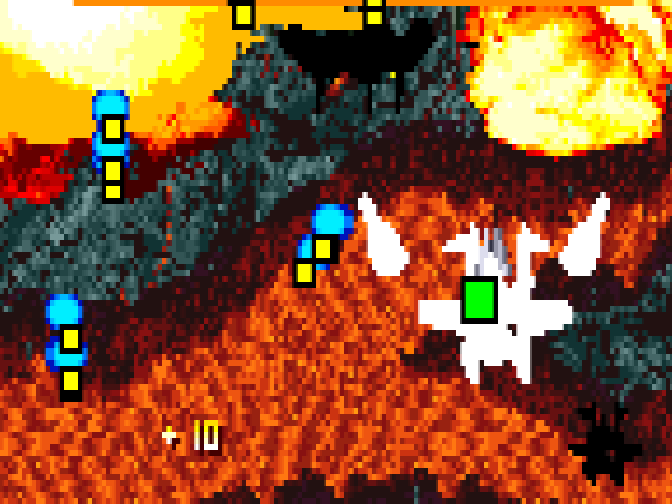
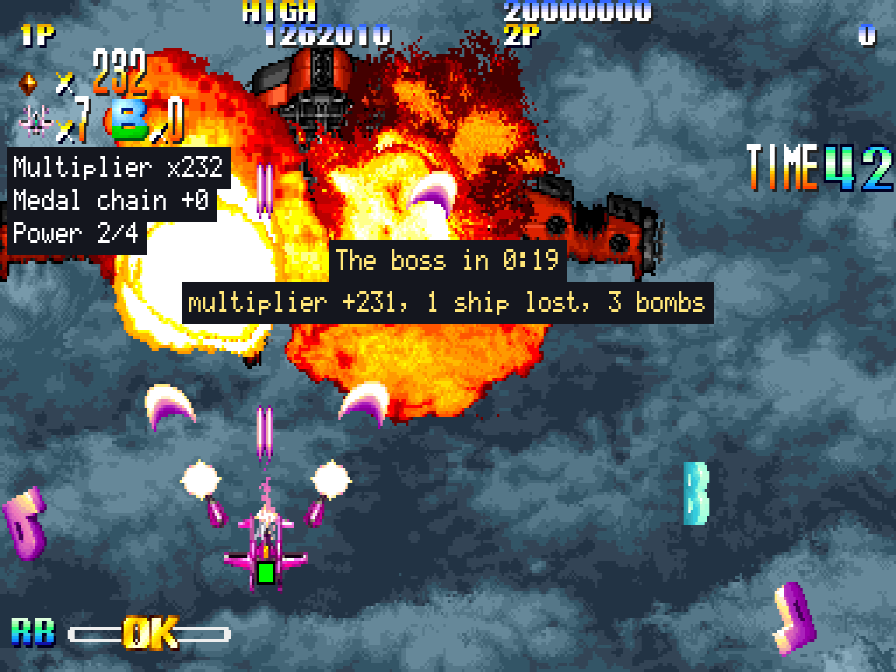
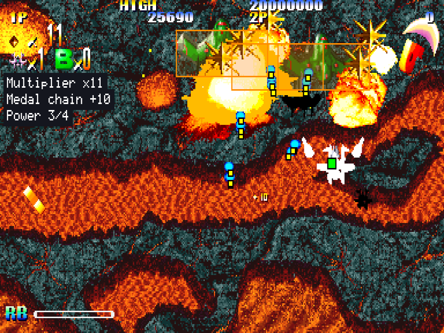

# Practice mode

The shoot-'em-ups' counterpart of the fighting games' [training mode](TRAINING.md). Giga Wing and Progear have it; the
shooters to come will share it (it lives in the toolkit, `shmup/`). The pictures here are Giga Wing's; Progear's
aids are the same, but its readout has the shot's power, and its summaries count the points scored (it has no
multiplier).

**Alternative modes** in the in-game menu has a **Practice** page: choose where and with what, then **Start**. The game
is taken there unseen in a moment (the board's start, the choice of fighter and the way to a boss are run as fast as
they go, your ship out of harm), and you play from there. Its aids are switches on the same page, and on the
launcher's Features page; they work only in practice.

## Where, and with what

| Choice | What it does |
| --- | --- |
| Stage | Any of the seven stages |
| Begin at | The stage's start, or **the boss**: met a few seconds before it comes on (the last stage is its boss from the start) |
| Fighter | Any of the four, or the hidden, unfinished fifth |
| Ships, bombs, power | As the game has them, or what you choose: up to nine ships, eight bombs, the shot's power from lowest to full |

## Again and again

- **Start over** (Backspace, or a gamepad's left shoulder): practice put back exactly as it began, at once. The start is
  kept in memory as a save state the moment it is reached, so there is no wait and nothing is different: the same
  enemies, the same shots.
- **Replay** (Backslash, or the left trigger held with the left shoulder): your last attempt shown again from the
  start, the controls as you pressed them. Touch the controls to take over from there.
- **The cheats** work in practice too (the other modes leave them out, as they keep scores): invincibility to learn a
  boss's patterns without dying, infinite ships, infinite bombs.
- **Slow motion and frame advance** are the menu's own: speed down to 1/8, pause, and a frame at a time. Save states
  (nine slots) work as everywhere.

## The aids

| Aid | What it shows |
| --- | --- |
| Hit boxes | Each ship's true hit box, green in a black edge: a 6-pixel square in the middle of the ship. It is the only part of the ship an enemy shot can hit |
| Enemy hit areas | Every enemy shot's hit point (yellow), which is the shot's tip, not its middle; and each enemy body's box (orange), which only the middle of your ship can touch |
| Readout | The scoring as it happens, at the left: the multiplier, the medal chain (what the next gold medal adds to the multiplier), the shot's power, the Reflect Barrier's charge while it charges or runs down, and the boss's clock |
| Summary | When a boss comes, when it is over and at a stage's end: how long it took, what the multiplier gained, the ships lost and the bombs used |

## The other modes

Score attack, caravan, boss rush and the stage viewer are on the same Alternative modes page: [MODES.md](MODES.md#the-shoot-em-ups).
