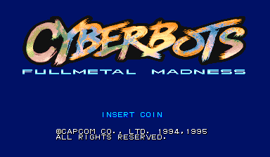
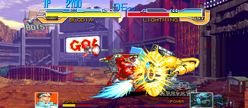

# Cyberbots Recomp

> Part of **[CPS-2 Recomp](../../README.md)**: one download and one launcher for every CPS-2 game this
> project has ported. This page is about Cyberbots; the [main page](../../README.md) says how to
> download and play.

An unofficial native PC port of the arcade game *Cyberbots: Fullmetal Madness* (Capcom, 1995, CPS-2 board) for macOS,
Linux (Steam Deck included) and Windows, made by static recompilation, with a full training mode.

Cyberbots is Capcom's giant-robot fighter: a pilot and a Variant Armor, four buttons (low attack, high attack, boost,
weapon), arms that break off, and a story for each pilot. Its program is its own, so this port has sources of its own
([how it works](PROGRESS.md)).

> **Beta.** The game plays and its code is checked instruction by instruction, but nobody has played it by hand
> yet. Expect rough edges, and please [report what you find](#feedback-and-contributing).

**No game files are included.** You need your own copy of the game: the arcade ROM set `cybots` (Europe 950424, the
set FBNeo and Fightcade play) with its key file, from a board you own. This project cannot help you get one.

This project is not affiliated with, endorsed by, or sponsored by Capcom. *Cyberbots* is a trademark of Capcom Co., Ltd.





## What it is

The game's 68000 program is translated ahead of time into C++ and compiled into the port; what the program expects of
the board is code written for this project, not an emulator.

- Plays with a keyboard, a gamepad or an arcade stick; every key and button can be changed, for each player, in the
  launcher. In the collection it can have a layout of its own, apart from the other games'.
- An in-game menu (Esc or `F1`; on a gamepad, the left stick's click or Start and Select together) with the training
  mode and the other modes, save states, speed (1/8 to 8x), the cheats, every feature, and a Reset all options row.
- **Zoom** on either fighter or both, as in the other fighting games ([the main page](../../README.md) has the buttons).
- **Pure** plays exactly as the board does. **Enhanced** (the default) adds free play (the game's own) and your own
  machine colours. Every other feature is a switch of its own.
- The board's operator settings (difficulty, damage level, timer speed, event, join in, continue, demo sound) on the
  Board page, each as the board is set unless you choose; or the game's own test menu from the in-game menu.
- **A custom soundtrack**: your own music in place of the board's, with the board's sound effects and voices; the
  `songs.txt` the game writes names its pieces (each stage's, the select screen, the story's, the ending).
  [How →](../../docs/SOUNDTRACK.md)
- **Hidden machines** (Game page): Super-8, Gaits, Warlock and Killer Bee: hold Start as you choose a machine, and the
  hidden one in its place of the list is yours.
- Your ROM set is only ever read. Settings, save states and the board's settings memory go in your own user folder, or
  beside the launcher in [portable mode](../../docs/LAUNCHER.md#portable-mode).

## Training mode

"Alternative modes" at the top of the in-game menu has a Training mode page: Start goes straight to the pilot and
machine choice with two players (player 1 chooses for both) and into a fight with no clock that nobody loses.

| Feature | What it does |
| --- | --- |
| Hit boxes | The boxes the game itself tests: where a machine can be hit (head, body and legs), attacks, and the push box |
| Frame data and frame meter | Startup, active and recovery of each move and the advantage after it, counted in the game's own steps; a row of coloured cells for each player, one a step |
| Input display | What each player presses and for how long, the stick as a keypad number, the buttons as LA, HA, B and W |
| Combo readout | Hits, damage, the round's best |
| Health refills | A player's health comes back when they have not been hit for a moment |
| The dummy | Stands, crouches, jumps, guards; records and replays, and can answer with a recording |
| Start over | The round as it began, in the middle or a corner, sides swapped or not |
| Stage | Any of the fourteen stages, or the game's own choice |

Also: save states, free play, and the cheats (no damage for either player, one-hit knockouts, infinite time).

## Alternative modes

| Mode | What it does |
| --- | --- |
| Training mode | A fight with no clock that nobody loses, and the aids above |
| Attract mode | The game's own show on a loop: everything, the introduction only, or one fight after another |
| Stage viewer | Any of the fourteen stages with nobody on it and no panel, its music playing |
| Model viewer | One machine by itself, on a stage or on plain white or black, at any size, standing and moving with your controls or going through any of its animations |
| Survival | One opponent after another on the health you have left |
| Endless battle | Two machines the game plays, for as long as you like; touch the controls to take one over |
| Ring out | No health: knock your opponent over the end of the stage, then jump down to the next |
| Colour editor | Change a machine's colours while you watch: custom colours, below |

## Its stages in the other games

With this game's ROM set beside theirs, its fourteen stages are in the stage lists of the games that show other
games' stages (Vampire Savior Definitive, the Alpha games, the Vampire Savior games): training, the stage viewer, the
endless and team battles. Each is run from Cyberbots' own stage code alone, its music too, with the other game's
fighters on it.

## Widescreen

A switch on the launcher's first page, under "Full screen" (and on the in-game menu's Display page). Fights are shown
and played in 16:9: the picture is 512 columns wide where the board's is 384, so there is a third more of the stage in
view. Off unless you switch it on, because it changes how the game plays (the players can stand further apart; the
camera stops 64 short of where it did). The bars and the faces stay in the middle.

**Invisible walls** (Display page) keeps the 16:9 picture and plays the game exactly as the board does.

## Custom colours

Give any machine colours of your own, with the colour editor (the machine in front of you, its two colour sets, seven
lines of 16 colours, 16 levels each of red, green and blue) or with text files, one a machine, in the `palettes` folder
of the game's user folder. Some palettes are shared by several machines in the game, and a change to one changes them
all; the two ice stages show the game's own colours, made for their light. A `cybe.04` changed with PalMod is read too
(not yet tried with PalMod itself).

## What you need

- The ROM set `cybots` (*Cyberbots: Fullmetal Madness*, Europe 950424): `cybots.zip` or a folder with the set's files,
  including `cybots.key`. The launcher checks every file by checksum and tells you which is missing or different.
- One of: macOS 13 or later (Apple silicon or Intel); Linux x86_64 or SteamOS; Windows 10 or 11, 64-bit.
- A gamepad or stick with four buttons or more is recommended.

## Playing

Cyberbots comes with [CPS-2 Recomp](../../README.md#getting-started): open its launcher and show it your ROM set (drop
`cybots.zip` or its folder on the window, or choose the folder you keep your sets in), then press **Play** beside
Cyberbots. From a terminal, `cps2recomp-launcher --play cybots` starts it straight away; the game's own program
(`cybots`, beside the launcher) runs by itself too: `cybots --help` lists what it takes.

## Building from source

With your own ROM set in `rom/cybots/` (ignored by Git), from the repository's top:

```sh
make GAME=cybots            # twice the first time
make GAME=cybots explore    # once: finds the game's code by made-up play and translates it
make GAME=cybots run
make GAME=cybots check-widescreen
```

[PROGRESS.md](PROGRESS.md) has what was found and how; [docs/BUILDING.md](../../docs/BUILDING.md) every platform.

## Feedback and contributing

Bug reports and pull requests are welcome: see [CONTRIBUTING.md](../../CONTRIBUTING.md) for the rules (above all:
nothing from the game, ever).

## License and credits

GPL-3.0-only (see [LICENSE](../../LICENSE)); [THIRD_PARTY_NOTICES.md](../../THIRD_PARTY_NOTICES.md) lists what comes
from other projects. The repository holds no game data.
