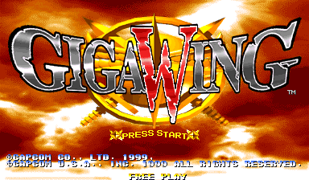
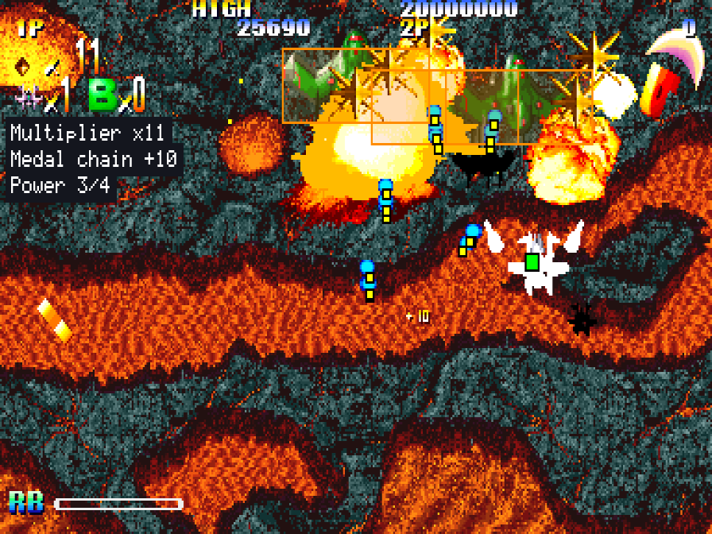

# Giga Wing Recomp

> Part of **[CPS-2 Recomp](../../README.md)**: one download and one launcher for every Capcom arcade game this
> project has ported. This page is about Giga Wing; the [main page](../../README.md) says how to download and play.

An unofficial native PC port of the arcade game *Giga Wing* (Takumi, published by Capcom, 1999, CPS-2 board) for
macOS, Linux (Steam Deck included) and Windows, made by static recompilation: the collection's first shoot-'em-up, for
one or two players, with a practice mode, a score attack, a caravan, a boss rush, free play, the board's own settings
and cheats.

> **Beta.** The game plays through its stages in made-up play and its code is checked instruction by instruction, but
> nobody has played it by hand yet, and its sound has not been listened to. Expect rough edges, and please
> [report what you find](#feedback-and-contributing).

**No game files are included.** You need your own copy of the game: the arcade ROM set `gigawing` (USA, 990222), from
a board you own, or the Asian, Hispanic or Brazilian set of the same date. This project cannot help you get one.

This project is not affiliated with, endorsed by, or sponsored by Capcom or Takumi. *Giga Wing* is a trademark of
Capcom.





## What it is

The game's 68000 program is translated ahead of time into C++ and compiled into the port, and so is its sound
program. What the program expects of the board is code written for this project, not an emulator: the CPS-2's video,
its inputs, its settings memory and QSound.

- **One or two players at once**, each with a keyboard layout or a gamepad of their own, and **online** against
  another player (rollback, as the other games). The buttons are called what the game calls them: **Shot** (held: the
  Reflect Barrier) and **Bomb**.
- An in-game menu (Esc or `F1`; on a gamepad, the left stick's click or Start and Select together) with save states,
  speed (1/8 to 8x: slow motion), pause and frame advance, rapid fire, run-ahead, the board's timing (its slowdown),
  the cheats and every feature.
- **Pure** plays exactly as the board does. **Enhanced** (the default) adds free play (the board's own). Every other
  feature is a switch of its own.
- **Practice**: any of the seven stages, from its start or straight at its boss, with the fighter, ships, bombs and
  power you choose. One button (Backspace, or a gamepad's left shoulder) puts it back as it began, at once; another
  replays your last attempt. Its aids: each ship's true hit box (a 6-pixel square, far smaller than the ship) and the
  point of every enemy shot, the enemies' bodies, a readout of the multiplier, the medal chain, the power and the
  boss's clock, and a summary at each boss and stage end (the time, what the multiplier gained, ships lost, bombs used).
- **Alternative modes**, at the head of the in-game menu:
  - **Score attack**: one player and one credit from the first stage, no continue and no cheats; the best score is
    kept.
  - **Caravan**: two, three or five minutes from the first stage, a ship for every one lost; the best score in the time
    is kept for each length.
  - **Boss rush**: every boss in turn, the way between them run unseen; the best score is kept, and the time.
  - **Stage viewer**: a stage scrolling by with nobody on it: no ships, enemies, shots or panel.
  - **Attract mode**: the game's own show on a loop, with its sound on: all of it, only the demonstrations or only
    the story.
- **Start at stage**: a new game starts at the beginning of any of the seven stages.
- **Custom soundtrack**: your own music files in place of the board's music ([how](../../docs/SOUNDTRACK.md)); the
  game names its pieces in `songs.txt`.
- **Cheats**: infinite ships, infinite force bombs, and invincibility for each player.
- The board's operator settings on the Board page (difficulty, ships, force bombs, continue, demo sound), each as the
  board is set unless you choose; or the game's own test menu from the in-game menu.
- **Straight to the title**: at a start or a reset, the board's start and its warning run unseen.
- **Slowdown**: with Arcade timing on, the game slows where the board does, as its memory waits and the video chip's
  are counted ([docs/TIMING.md](../../docs/TIMING.md)); off, the processor always has time and the game seldom slows.
- Your ROM set is only ever read. Settings, save states and the board's settings memory go in your own user folder,
  or beside the launcher in [portable mode](../../docs/LAUNCHER.md#portable-mode).

## What you need

- The ROM set `gigawing` (*Giga Wing*, USA 990222): `gigawing.zip` or a folder with the set's files, the key file
  `gigawing.key` among them. The Asian (`gigawinga`), Hispanic (`gigawingh`) and Brazilian (`gigawingb`) sets of the
  same date play too. The launcher checks every file by checksum and tells you which is missing or different.
- One of: macOS 13 or later (Apple silicon or Intel); Linux x86_64 or arm64, or SteamOS; Windows 10 or 11, 64-bit.
- For two players: two gamepads, or keys chosen for the second player on the Controllers page.

## Playing

Giga Wing comes with [CPS-2 Recomp](../../README.md#getting-started): open its launcher and show it your ROM set
(drop `gigawing.zip` or its folder on the window, or choose the folder you keep your sets in), then press **Play**
beside Giga Wing. From a terminal, `cps2recomp-launcher --play gigawing` starts it straight away; the game's own
program (`gigawing`, beside the launcher) runs by itself too: `gigawing --help` lists what it takes.

## Building from source

With your own ROM set in `rom/gigawing/` (ignored by Git), from the repository's top:

```sh
make GAME=gigawing            # twice the first time
make GAME=gigawing explore    # once: finds the game's code by made-up play and translates it
make GAME=gigawing run
make GAME=gigawing check
```

[PROGRESS.md](PROGRESS.md) has what was found of the game; [docs/BUILDING.md](../../docs/BUILDING.md) has every
platform.

## Feedback and contributing

Bug reports and pull requests are welcome: see [CONTRIBUTING.md](../../CONTRIBUTING.md) for the rules (above all:
nothing from the game, ever).

## License and credits

GPL-3.0-only (see [LICENSE](../../LICENSE)); [THIRD_PARTY_NOTICES.md](../../THIRD_PARTY_NOTICES.md) lists what comes
from other projects. The repository holds no game data and no key: the names header's addresses are numbers.
