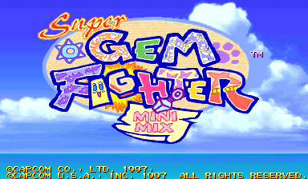

# Super Gem Fighter Mini Mix Recomp

> Part of **[CPS-2 Recomp](../../README.md)**: one download and one launcher for every CPS-2 game this
> project has ported. This page is about Super Gem Fighter Mini Mix (*Pocket Fighter* in Japan); the
> [main page](../../README.md) says how to download and play.

An unofficial native PC port of the arcade game *Super Gem Fighter Mini Mix* (*Pocket Fighter*; Capcom, 1997,
CPS-2 board) for macOS, Linux (Steam Deck included) and Windows, made by static recompilation.

This is the game as the board plays it, with the features every game here shares: free play, straight to the
title, the board's operator settings, cheats, save states, run-ahead, arcade timing, a custom soundtrack. It has
**no training mode yet**, nor the alternative modes, widescreen or custom colours that the other fighting games'
ports have; those are next ([PROGRESS.md](PROGRESS.md)).

> **Beta.** The game plays from start to ending and its code is checked instruction by instruction, but it has
> been played on few machines and controllers yet. Expect rough edges, and please
> [report what you find](#feedback-and-contributing).

**No game files are included.** You need your own copy of the game: the arcade ROM set `sgemf` (USA, 970904)
with its key file, from a board you own. **Only that version works.** This project cannot help you get one.

This project is not affiliated with, endorsed by, or sponsored by Capcom. *Super Gem Fighter* and *Pocket Fighter*
are trademarks of Capcom Co., Ltd.




## What it is

The game's 68000 program is translated ahead of time into C++ and compiled into the port, and so is its sound
CPU's (Capcom's sound driver 1.30). What the program expects of the board (its video, the QSound chip, the sound
CPU and its registers, the settings memory) is code written for this project, not an emulator. Every translated
block is checked against an interpreter of the same program ([how it was made](PROGRESS.md)).

- Plays with a keyboard, a gamepad or an arcade stick; every key and button can be changed, for each player, in
  the launcher. The game has three buttons: Punch, Kick and Special.
- An in-game menu (Esc or `F1`; on a gamepad, the left stick's click or Start and Select together) with save
  states, speed, the cheats and every feature.
- **Rapid fire** (Game page): a button held down is pressed again and again, fifteen times a second, for the first
  button or for all of them; the first press is seen at once.
- **Pure** plays exactly as the board does. **Enhanced** (the default) adds free play: the game's own, one of the
  board's coin settings, so the screen says FREE PLAY. Every other feature is a switch of its own.
- **Straight to the title** (Game page): at a start or a reset, everything before the title (the board's start,
  the warning, the notices and the introduction) runs unseen; with a coin in, the picture comes back with the title
  that asks for Start.
- The board's operator settings (difficulty, damage level, timer speed, game speed, rounds and the rest) on the
  Board page (launcher's Features, in-game menu), each as the board is set unless you choose; or the game's own
  test menu from the in-game menu.
- Cheats: no damage (each player), one-hit knockouts, infinite time.
- **Arcade timing** (Game page, off unless chosen): the processor run as on the arcade board, so the game slows
  down where and as much as the board does. [More →](../../docs/TIMING.md)
- **Run-ahead** (Game page): what you press seen a frame or two sooner than on the board, with the game running
  exactly as without it.
- **A custom soundtrack**: your own music in place of the board's, with the board's sound effects and voices: a
  folder of music plays as a playlist (in order or shuffled), or files named for the game's songs replace those
  songs (the `songs.txt` the game writes lists them by number; their names are still to be found).
  [How →](../../README.md#a-custom-soundtrack)
- Your ROM set is only ever read. Settings, save states and the board's settings memory go in your own user folder.

## The board's settings

The Board page has nine settings of the test menu's Configuration, each "As the board is set" unless chosen.
A choice is what the test menu would have set; the board's settings memory itself is not changed, and the test
menu shows the board's own values.

| Setting | Choices | The board's own (a new board) |
| --- | --- | --- |
| Difficulty | Easy, Normal, Hard 1 to 5, Expert | Hard 3 |
| Damage level | Low, Normal, High, Maximum | Normal |
| Timer speed | Slow, Normal, Fast, Fastest | Slow |
| Game speed | Turbo 1 to 4, Free select | Free select |
| Max round | 1, 3 or 5 rounds | 3 rounds |
| Event | Off, one match (and no continue) | Off |
| Join-in | Off, On (a second player can join a game against the computer) | On |
| Continue | Off, On | On |
| Demo sound | Off, On | On |

## What you need

- The ROM set `sgemf` (*Super Gem Fighter: Mini Mix*, USA 970904): `sgemf.zip` or a folder with the set's files,
  including `sgemf.key`. The launcher checks every file by checksum and tells you which is missing or different.
  Sets of other regions are refused (`pfghtj`, the Japanese *Pocket Fighter*, among them): the port is made from
  this one version's program, and its features use addresses found in it.
- One of: macOS 13 or later (Apple silicon or Intel); Linux x86_64 or SteamOS; Windows 10 or 11, 64-bit.
- A gamepad or stick with three buttons or more is recommended.

## Playing

Super Gem Fighter Mini Mix comes with [CPS-2 Recomp](../../README.md#playing): open its launcher and show it your ROM
set (drop `sgemf.zip` or its folder on the window, or choose the folder you keep your sets in), then press **Play**
beside Super Gem Fighter Mini Mix. From a terminal, `cps2recomp-launcher --play pocket_fighter` starts it straight
away; the game's own program (`pocket_fighter`, beside the launcher) runs by itself too: `pocket_fighter --help`
lists what it takes.

While playing, Esc or `F1` (on a gamepad, the left stick's click, or Start and Select together) opens the in-game
menu. Only the menu's "Quit game" row (or closing the window) ends the game.

## Building from source

With your own ROM set in `rom/pocket_fighter/` (ignored by Git), CMake, Ninja, SDL 3 and Python 3,
from the repository's top:

```sh
make GAME=pocket_fighter            # twice the first time
make GAME=pocket_fighter explore    # once, about five minutes: finds the game's code by made-up play and translates it
make GAME=pocket_fighter run
make GAME=pocket_fighter check FRAMES=40000 MOVIE=games/pocket_fighter/movies/ladder.txt
```

[docs/BUILDING.md](../../docs/BUILDING.md) has every platform, the checks and the release builds, and
[PROGRESS.md](PROGRESS.md) what was found about the game and what is next.

## Feedback and contributing

Bug reports and pull requests are welcome: see [CONTRIBUTING.md](../../CONTRIBUTING.md) for the rules (above all:
nothing from the game, ever).

## License and credits

GPL-3.0-only (see [LICENSE](../../LICENSE)); [THIRD_PARTY_NOTICES.md](../../THIRD_PARTY_NOTICES.md) lists what comes
from other projects. The repository holds no game data and nothing derived from it.
