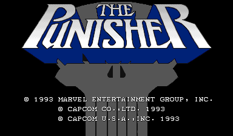
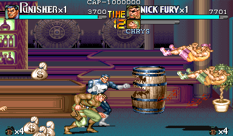
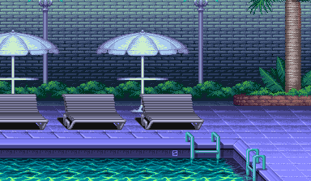

# The Punisher Recomp

> Part of **[CPS-2 Recomp](../../README.md)**: one download and one launcher for every Capcom arcade game this
> project has ported. This page is about The Punisher; the [main page](../../README.md) says how to download and play.

An unofficial native PC port of the arcade game *The Punisher* (Capcom, 1993, CPS-1 board with QSound) for macOS,
Linux (Steam Deck included) and Windows, made by static recompilation: a beat-'em-up for two players, the Punisher and
Nick Fury, with free play, a stage to start at, a score attack, viewers for its stages and characters, the board's own
settings and cheats.

> **Beta.** The game plays through its stages in made-up play and its code is checked instruction by instruction, but
> nobody has played it by hand yet, and its sound has not been listened to. Expect rough edges, and please
> [report what you find](#feedback-and-contributing).

**No game files are included.** You need your own copy of the game: the arcade ROM set `punisheru` (USA, 930422), from
a board you own. This project cannot help you get one.

This project is not affiliated with, endorsed by, or sponsored by Capcom or Marvel. *The Punisher* and *Nick Fury* are
trademarks of Marvel Characters, Inc.





## What it is

The game's 68000 program is translated ahead of time into C++ and compiled into the port, and so is its sound
program. What the program expects of the board is code written for this project, not an emulator: the CPS-1's
video, its inputs, its settings memory and QSound, as for Cadillacs and Dinosaurs. The sound program's key is worked
out from your own ROM when it loads, as for that game; no key is in this repository.

- **Two players at once**, each with a keyboard layout or a gamepad of their own: player 1 is the Punisher, player 2
  Nick Fury.
- Plays with a keyboard, a gamepad or an arcade stick; every key and button can be changed, for each player, in the
  launcher, where the buttons are called what the game calls them: **Attack** and **Jump** (both together: the special
  attack). In the collection it can have a layout of its own, apart from the other games'.
- An in-game menu (Esc or `F1`; on a gamepad, the left stick's click or Start and Select together) with save states,
  speed (1/8 to 8x), pause and frame advance, the cheats, every feature, and a Reset all options row.
- **Pure** plays exactly as the board does. **Enhanced** (the default) adds free play (the board's own). Every other
  feature is a switch of its own.
- **Start at stage**: a new game starts at the beginning of any of the six stages.
- **Alternative modes**, at the head of the in-game menu:
  - **Attract mode**: the game's own show on a loop, with its sound on: all of it, or only the story, only the
    demonstrations, or only the profiles of the Punisher and Nick Fury.
  - **Score attack**: one player and one credit from the first stage, no continue and no cheats, for the best score,
    which is kept.
  - **Stage viewer**: each stage's first stretch with nobody on it, only the scenery and its music, scrolled with the
    stick or by itself (slow, medium, fast), or every stage in turn.
  - **Model viewer**: the Punisher or Nick Fury by themselves, on a stage or on white or black, from a quarter of their
    size to 25 times, moved with your controls or going through any of their animations, in slow motion if you like.
- **Custom soundtrack**: your own music files in place of the board's music ([how](../../docs/SOUNDTRACK.md)); the
  game names its pieces in `songs.txt` (each stage's music and title, the bosses', the bonus round, continue).
- **Cheats**: infinite health, infinite lives and infinite time (the stage's clock stands still), for both players.
- The board's operator settings on the Board page (difficulty, lives, extend, continue, demo sound, player select),
  each as the board is set unless you choose; or the game's own test menu from the in-game menu.
- **Straight to the title**: at a start or a reset, the board's start, its warning and the story run unseen.
- Your ROM set is only ever read. Settings, save states and the board's settings memory go in your own user folder,
  or beside the launcher in [portable mode](../../docs/LAUNCHER.md#portable-mode).



## What you need

- The ROM set `punisheru` (*The Punisher*, USA 930422): `punisheru.zip` (with `punisher.zip` beside it if your
  collection keeps the shared files there) or a folder with the set's files. It has no key file. The launcher checks
  every file by checksum and tells you which is missing or different.
- One of: macOS 13 or later (Apple silicon or Intel); Linux x86_64 or SteamOS; Windows 10 or 11, 64-bit.
- For two players: two gamepads, or keys chosen for the second player on the Controllers page.

## Playing

The Punisher comes with [CPS-2 Recomp](../../README.md#getting-started): open its launcher and show it your ROM set
(drop `punisheru.zip` or its folder on the window, or choose the folder you keep your sets in), then press **Play**
beside The Punisher. From a terminal, `cps2recomp-launcher --play punisher` starts it straight away; the game's own
program (`punisher`, beside the launcher) runs by itself too: `punisher --help` lists what it takes.

## Building from source

With your own ROM set in `rom/punisher/` (ignored by Git), from the repository's top:

```sh
make GAME=punisher            # twice the first time
make GAME=punisher explore    # once: finds the game's code by made-up play and translates it
make GAME=punisher run
make GAME=punisher check
```

[PROGRESS.md](PROGRESS.md) has what was found of the game; [docs/TOOLKIT.md](../../docs/TOOLKIT.md) has the CPS-1
board; [docs/BUILDING.md](../../docs/BUILDING.md) has every platform.

## Feedback and contributing

Bug reports and pull requests are welcome: see [CONTRIBUTING.md](../../CONTRIBUTING.md) for the rules (above all:
nothing from the game, ever).

## License and credits

GPL-3.0-only (see [LICENSE](../../LICENSE)); [THIRD_PARTY_NOTICES.md](../../THIRD_PARTY_NOTICES.md) lists what comes
from other projects. The repository holds no game data and no key: the names header's addresses are numbers, and the
sound program's key is worked out from the player's own ROM.
