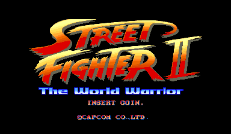
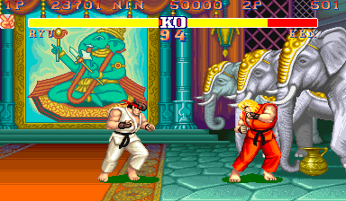

# Street Fighter II: The World Warrior Recomp

> Part of **[CPS-2 Recomp](../../README.md)**: one download and one launcher for every Capcom arcade game this
> project has ported. This page is about Street Fighter II: The World Warrior; the [main page](../../README.md) says how
> to download and play.

An unofficial native PC port of the arcade game *Street Fighter II: The World Warrior* (Capcom, 1991, CPS-1 board)
for macOS, Linux (Steam Deck included) and Windows, made by static recompilation.

The World Warrior is the first Street Fighter II: eight characters to choose, and the four bosses the computer plays.
Champion Edition was made from its program, and Super Street Fighter II Turbo's grew out of that line, so this port
builds the same sources as the
[Super Street Fighter II Turbo port](../ssf2t/README.md), with this game's own places and board, so it has what that
one has but what Super Turbo added to the game (super combos, the hidden characters, the speeds).

It has a full **training mode** (hit boxes, frame data and a frame meter, input display, combo and stun readouts, a
dummy that records, replays and guards), the **alternative modes** (attract mode, the stage and model viewers,
survival, endless battle, ring out, a tag team battle), **widescreen**, **custom colours** with a colour editor, and
the features every game shares: free play, straight to the title, the board's DIP switches, cheats, save states,
run-ahead, arcade timing, a custom soundtrack.

> **Beta.** The game plays from start to ending and its code is checked instruction by instruction, but nobody has
> played it by hand yet. Expect rough edges, and please [report what you find](#feedback-and-contributing).

**No game files are included.** You need your own copy of the game: the arcade ROM set `sf2` (World, 910522), from
a board you own. This project cannot help you get one.

This project is not affiliated with, endorsed by, or sponsored by Capcom. *Street Fighter* is a trademark of Capcom
Co., Ltd.





## What it is

The game's 68000 program is translated ahead of time into C++ and compiled into the port, and so is its sound CPU's.
The board is the toolkit's classic CPS-1 (no QSound): the Z80 drives a YM2151 ([ymfm](https://github.com/aaronsgiles/ymfm))
and an OKI MSM6295 (`sound/okim6295.cpp`). Everything the port adds is Super Turbo's sources, which name the places they
use in Super Turbo's program; this game's `family.h` says where each is here ([how it was made](PROGRESS.md)).

Training mode, the alternative modes, widescreen and its invisible walls, the colour editor, the zoom, the in-game menu
and the rest work as on the [Super Turbo page](../ssf2t/README.md), with these differences:

- No super combo gauge, no game speed. The four bosses are the computer's here (as on the board); training mode, the
  model viewer and the other modes have all twelve.
- **Free play** is the board's own DIP switch, set by the feature.
- **The Board page** is the board's DIP switches: difficulty, continue, demo sound, two coins to start.
- **Custom colours**: each character has one set (Normal) of one palette; no two players can choose the same
  character here. The program is in byte-wide pairs of files, so there is no PalMod file: text files only.
- **A custom soundtrack**: on the classic board too. [The list of its songs](../../docs/SONGS.md#street-fighter-ii-the-world-warrior)
  names the music. A replaced tune stops the board's sound effects for a moment as it starts (the classic sound program
  has no command that stops only its music). [How →](../../docs/SOUNDTRACK.md)

## What you need

- The ROM set `sf2` (*Street Fighter II: The World Warrior*, World 910522): `sf2.zip` or a folder with its files.
  A merged zip with its clones in it works too: the launcher finds each file by checksum. Other regions and revisions
  are refused.
- One of: macOS 13 or later; Linux x86_64 or SteamOS; Windows 10 or 11, 64-bit.
- A gamepad or stick with six buttons is recommended.

## Building from source

With your own ROM sets in `rom/sf2/` and `rom/ssf2t/` (ignored by Git; Super Turbo's is needed only to make
`family.h` again), CMake, Ninja, SDL 3 and Python 3, from the repository's top:

```sh
make GAME=sf2            # twice the first time
make GAME=sf2 explore    # once: finds the game's code by made-up play and translates it
make GAME=sf2 run
make GAME=sf2 check FRAMES=46000 MOVIE=games/sf2/movies/ladder.txt ARGS="--features free_play,no_damage,one_hit"
```

[docs/BUILDING.md](../../docs/BUILDING.md) has every platform, the checks and the release builds, and
[PROGRESS.md](PROGRESS.md) what was found about the game and what is next.

## Feedback and contributing

Bug reports and pull requests are welcome: see [CONTRIBUTING.md](../../CONTRIBUTING.md) for the rules (above all:
nothing from the game, ever).

## License and credits

GPL-3.0-only (see [LICENSE](../../LICENSE)); [THIRD_PARTY_NOTICES.md](../../THIRD_PARTY_NOTICES.md) lists what comes
from other projects. The repository holds no game data and nothing derived from it.
