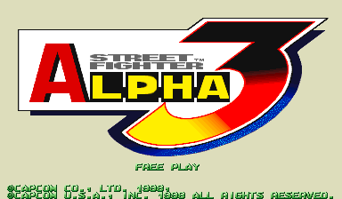
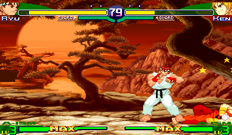
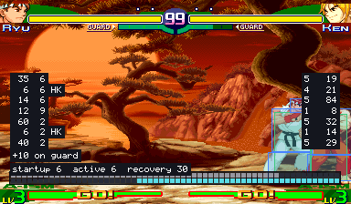
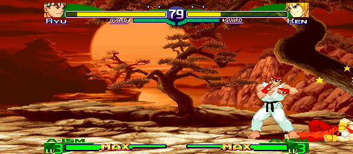

# Street Fighter Alpha 3 Recomp

> Part of **[CPS-2 Recomp](../../README.md)**: one download and one launcher for every CPS-2 game this
> project has ported. This page is about Street Fighter Alpha 3; the [main page](../../README.md) says how to
> download and play.

An unofficial native PC port of the arcade game *Street Fighter Alpha 3* (Capcom, 1998, CPS-2 board; *Street Fighter
Zero 3* in Japan) for macOS, Linux (Steam Deck included) and Windows, made by static recompilation. It is made from the
980904 revision, the last one, which Alpha 3 is played on in tournaments and online.

It has everything the other fighting games here have: a full **training mode** (hit boxes and throw range, frame data
and a frame meter, input display, combo, stun and custom combo readouts, fixed damage, a dummy that guards high or low
as each attack needs, Alpha counters, techs throws, rises quickly, mashes out of stun, records and replays), the
**alternative modes** (attract mode, the stage and model viewers, survival, endless battle, ring out, and the tag team
battle with its Marvel-style tag style), **widescreen**, **custom colours** with a colour editor, the **hidden
characters** with no code (Balrog, Juni and Juli), and the features every game shares: free play, straight to the
title, the board's operator settings, cheats, save states, run-ahead, arcade timing, a custom soundtrack.

**[Get started: download it and play →](#playing)**

> **Beta.** The game plays from start to ending and its code is checked instruction by instruction, but it has been
> played on few machines and controllers yet. Expect rough edges, and please
> [report what you find](#feedback-and-contributing).

**No game files are included.** You need your own copy of the game: the arcade ROM set `sfa3u` (USA, 980904) with its
key file, from a board you own. **Only that version works.** This project cannot help you get one.

This project is not affiliated with, endorsed by, or sponsored by Capcom. *Street Fighter* is a trademark of Capcom
Co., Ltd.





## What it is

The game's 68000 program is translated ahead of time into C++ and compiled into the port, and so is its sound CPU's
(Capcom's sound driver 1.71). The routines widescreen and the modes change (the camera's place across and up, and
keeping the players inside the picture, alone and in a throw) are rewritten by hand as readable C++, each checked call
by call against the game's own code. What the program expects of the board (its video, the QSound chip, the sound CPU
and its registers, the settings memory) is code written for this project, not an emulator. Every translated block is
checked against an interpreter of the same program ([how it was made](PROGRESS.md)).

- Plays with a keyboard, a gamepad or an arcade stick; every key and button can be changed, for each player, in the
  launcher. Two more can be given a key or a button: all three punches at once, and all three kicks. In the collection
  it can have a layout of its own, apart from the other games'.
- An in-game menu (Esc or `F1`; on a gamepad, the left stick's click or Start and Select together) with the
  training mode and the other modes, save states, speed (1/8 to 8x), the cheats,
  every feature, and a Reset all options row.
- **Zoom**: hold the left stick's click and press the left shoulder to zoom in on player 1's fighter, the right
  shoulder for player 2's (keyboard: hold Left Shift and press Q or E). Each press for the same player goes a size
  up, 1.25x, 1.5x, 1.75x and 2x (the model viewer's sizes: at 2x the top of a tall fighter is off the screen), then
  back to the whole picture; a press for the other player looks at that one instead. The fighter is kept in the
  middle all the while (past the stage's ends is black); with the click (or Left Shift) still held, the d-pad or
  the stick (the arrows) moves the camera to frame it as you like, until the zoom is off or looks at the other fighter. The size eases from one
  to the next, it is said at the bottom for a few seconds, and outside a fight the picture is whole again. The
  game's own health bars are zoomed with it; the port's own text (a mode's score, the training display) is not.
  With the left stick's click held, the right stick's click (keyboard: Left Shift and W) keeps **both fighters** in
  the picture instead: the camera as close as shows both whole, tight when they are close and wide when they are
  apart (2x at most, the whole picture at least), kept inside the stage; again for the whole picture. The left
  stick's click alone still opens the menu, when it is let go.
- **Rapid fire** (Game page): a button held down is pressed again and again, fifteen times a second, for the first
  button or for all of them; the first press is seen at once.
- **Pure** plays exactly as the board does. **Enhanced** (the default) adds free play and your own
  [character colours](#custom-colours). Every other feature is a switch of its own.
- **Free play** is the game's own: the coin mode of its test menu, which the feature sets as the board's start would.
  The title says FREE PLAY, and Start goes straight to the character choice.
- **Straight to the title** (Game page): at a start or a reset, everything before the title (the board's start, the
  warning, the notices and the introduction) runs unseen; the picture comes back with the title.
- The board's operator settings (difficulty, damage level, timer speed, game speed, the rounds of a match, event,
  join-in, continue, demo sound) on the Board page (launcher's Features, in-game menu), each as the board is set unless
  you choose; or the game's own test menu from the in-game menu.
- Cheats: no damage, full gauge and no stun (each player), one-hit knockouts, infinite time.
- **Hidden characters** (Game page): Balrog, Juni and Juli, whom the board gives only by its time release, with no
  code: hold Start as you choose M. Bison for Balrog, Cammy for Juni, or Rose for Juli.
- A search box on the launcher's Features page (Ctrl+F or Cmd+F) finds any feature by a word in its name, description
  or choices.
- **Arcade timing** (Game page, off unless chosen): the processor run as on the arcade board, so the game slows
  down where and as much as the board does. [More →](../../docs/TIMING.md)
- **Run-ahead** (Game page): what you press seen a frame or two sooner than on the board, with the game running
  exactly as without it.
- **A custom soundtrack**: your own music in place of the board's, with the board's sound effects and voices: a folder
  of music plays as a playlist (in order or shuffled), or files named for the game's songs replace those songs. The
  `songs.txt` the game writes in the soundtrack folder names its music: each character's theme, the ladder's last
  fights and M. Bison's, player select, the characters' introductions, the winner's, continue, game over, the ending
  and the rankings. [How →](../../README.md#a-custom-soundtrack)
- Your ROM set is only ever read. Settings, save states and the board's settings memory go in your own user folder.

## Training mode

"Alternative modes" at the top of the in-game menu has a Training mode page: Start goes straight to the character
choice with two players (player 1's controls choose for both, the ism too) and into a fight with no clock that nobody
loses, and the page holds the aids below.

| Feature | What it does |
| --- | --- |
| Hit boxes | The boxes the game itself tests: where a player can be hit (blue), attacks (red; orange for things thrown), pushing boxes (green) |
| Throw range | The box in front of each player that the other's push box has to touch for a throw, as the game tests it (each character's once it has tried a throw) |
| Frame data and frame meter | Startup, active and recovery of each move and the advantage after a hit or a guarded hit, counted in the game's own steps; a row of cells for each player, one a step; optionally every move written to `frame_data.csv` beside the settings |
| Input display | What each player presses and for how long, in numpad notation from the player's side |
| Combo readout | Hits and damage of a combo, the round's best |
| Custom combo time | How long a V-ism custom combo has left |
| Stun readout | How much stun each player has taken, against how much stuns them (more each time they have been stunned) |
| Fixed damage | No random part in a hit's damage (the average in its place), so a combo always does the same |
| Health refills | Health comes back when a player has not been hit for a moment |
| The dummy | Stands, crouches, jumps; guards (always, after a hit, at random; high or low by the game's own rule for each attack); Alpha counters while guarding; techs throws; rises quickly after a knock-down; mashes out of stun; or is played by the game's own computer player; records and replays in three slots (one, or any at random), and can answer with a recording after guarding or being hit |
| Start over | The round as it began, in the middle or a corner, sides swapped or not (Backspace, or a gamepad's left shoulder) |
| Stage | Any of the 26 stages, or the game's own choice |
| Stop, step, slow | Stop the game, go on a frame at a time, or play at a half, a quarter or an eighth of the speed |

Also: save states in nine slots, free play, and the cheats (no damage, full gauge and no stun for each player, one-hit
knockouts, infinite time).



## Alternative modes

The in-game menu's first row, "Alternative modes", has ways of playing and watching the game that the board does not
have. Each has a page with a Start row and its own choices, and runs until another is started or the menu's Reset game.

| Mode | What it does |
| --- | --- |
| Training mode | A fight with no clock that nobody loses, and the aids above |
| Attract mode | The game's own show on a loop: everything, the introduction only, or one demonstration fight after another |
| Stage viewer | Any of the 26 stages with nobody on it and no panel, scrolled with the stick or by itself, with any tune; "Infinite" scrolls through every stage in turn |
| Model viewer | One character by itself, on a stage or on plain white or black, from a quarter of its size to 25 times. It stands and moves with your controls, or goes through any of its animations (named A0, B12, C3... as the game's own four lists number them; left and right step through them), over and over or all of them one after another (Play all), at full speed or in slow motion |
| Colour editor | Change a character's colours while you watch: [custom colours](#custom-colours) |
| Survival | One computer opponent after another on the health you have left. How many can you beat? |
| Endless battle | Two fighters the game plays, for as long as you like, with no clock, on one stage, on stages that fade one into another, or on a floor that scrolls through them all. Touch the controls to take a fighter over |
| Ring out | No knock-outs. Knock your opponent over the end of the stage (it is flung into the air, as by a knock-down, and falls through the floor), then jump down after it and land on the next stage. The CPU plays it as a ring out, not for damage, and guards as it always does: it throws or sweeps you when your back is to an end, and keeps off its own end, getting out of a corner with a throw, a jump over you or a walk out, more or less often by its difficulty |
| Tag team battle | Two teams of two or three, chosen on its page: one fighter of each team at a time, all on one stage. Team 2 is the CPU (its difficulty chosen on the page), or player 2; with "Tag team" on the same page, each fighter is a person's own: co-op (players 1 and 2 against the computer's team) or 2 vs 2 for four players. **Tag style**, the default: Marvel-style, each fighter keeps a bar of its own and you tag the next one in with a gamepad's left trigger (or Start) whenever yours can act; the next one jumps in from that side with a jump attack that can hit. When a bar empties, that fighter is knocked down and lies there, not to be hit, and the next one jumps in; resting fighters get back the health that comes back by itself, the team's super combo gauge carries over, one round decides it, and a time over goes to the team with more health in all. The CPU's team tags too, as a person would: when the one on is low and a partner has more (or has rested), while you are knocked down, never in the middle of your combo, and more or less often by its difficulty. "Style: Knock-out" plays one fighter at a time instead: the one knocked down is out, and the next comes on with a full bar |

## Widescreen



A switch on the launcher's first page, under "Full screen" (and on the in-game menu's Display page). Fights are shown
and played in 16:9: the picture is 512 columns wide where the board's is 384, at the same height and with everything
the same size, so there is a third more of the stage in view.

It is **off unless you switch it on**, in every preset, because it changes how the game plays:

- The players can go to the wide picture's edges, so they can stand further apart than on the board. The stage's own
  ends are where they were.
- The camera stops 64 short of where it did, so that the picture ends where the stage does.
- The bars, the clock and the gauges stay in the middle. Survival, the endless battle, the ring out and the tag team
  battle are wide too; the stage and model viewers and everything that is not a fight keep the board's 4:3.

With it off the game is exactly the board's. Nothing here stretches the picture: the extra columns are the game's own
stage art, which the board already holds and never showed; the planes far behind are kept inside their painting, and
on all 26 stages the wide picture's edges are painted.

**Invisible walls**, on the Display page, keeps the 16:9 picture and plays the game exactly as the board does: the
players are stopped where the board's picture ends, by walls that are not seen, and the camera goes as far as the
board's. Near a stage's end the view stays on the stage, so the play area is then to one side of the wide picture. The
game's memory is the same as with widescreen off, frame for frame (`make GAME=sfa3 check-widescreen` compares it along
the ladder).

## The picture

The Display page (in the launcher and the in-game menu) says how the picture fits the window or screen:

| Row | Choices |
| --- | --- |
| Scaling | Sharp (each pixel a crisp block), Whole pixels (every pixel the same whole number of the screen's pixels tall, a border round it), Smooth |
| Picture shape | 4:3 (as the arcade's monitor showed it), Square pixels, Fill |
| Shader | Off, or the picture through one of RetroArch's shaders: CRT (a curved arcade monitor), CRT Lottes, CRT Royale, CRT Guest, CRT Light, Scanlines (light, strong, OSSC or dark), xBRZ, ScaleFX, or Your own (a `.slangp` preset in the `shaders` folder beside the game's settings); the launcher chooses which of them the menu goes through |
| Window size | 3x the board's 224 lines, or 2x to 6x |

The first of each is the default, and how it has always been drawn.

## Custom colours

Give any character colours of your own: change them in the game's colour editor, or bring files someone else made.

**The colour editor** is on the in-game menu's "Alternative modes" page. It shows the character with a panel at the
right, worked with player 1's controls: up and down choose a row, left and right change it.

- **Character, background, size, animation**: who you are dressing, on what, how large, standing or going through one
  of their animations.
- **Set**: which of the character's six colour sets, by how it is chosen: each ism (X, A, V) chosen with a punch (P) or
  a kick (K): XP, XK, AP, AK, VP, VK.
- **Line**: the character's own colours, or one of four lines for their effects.
- **Colour, Red, Green, Blue**: one of the line's 15 colours (it blinks on the character when you choose it), and its
  red, green and blue in the board's 16 levels each.
- **Random colours**: every colour of the set at random, at a second press on its row (LK, left or right, twice), so
  that one press by mistake loses nothing. HK puts back the colours from before the random ones, until the next change.
- **Save set** and **Load**: keep a set you like in the character's library and put it back later, into this set or
  any other. Left and right on Load try each saved one on the character; LP loads it, MK twice deletes it, and moving
  off the row without loading puts your colours back.
- LP copies a colour, MP pastes it, HP gives back the game's; the menu page puts back the game's colours for the whole
  set or the whole character.

Changes show at once and are saved as you go. **To play in them, choose the character's ism with the button of the
set you changed** (Sakura's A-ism with a punch, say), anywhere: arcade, versus, training.

**Files.** What you change goes in a `palettes` folder beside `settings.ini`, a text file a character (`Sakura.txt`)
holding only the sets that are not the game's. The folder is:

| System | Folder |
| --- | --- |
| Windows | `%APPDATA%\Street Fighter Alpha 3\palettes` (paste it into Explorer's address bar; it is the `AppData\Roaming` folder in your user folder) |
| macOS | `~/Library/Application Support/Street Fighter Alpha 3/palettes` |
| Linux, SteamOS | `~/.local/share/Street Fighter Alpha 3/palettes` |
| [Portable mode](../../README.md#portable-mode) | `user/Street Fighter Alpha 3/palettes` beside the launcher |

You can write or share them by hand: "Write the game's colours" (on the colour editor's page of the menu) puts every
character's own colours in `palettes/original` to start from, each set up to five lines of 16 colours (`#RRGGBB` or
`#RGB`; `-` keeps the game's). Saved sets are files too, one a set, in `palettes/library/<Character>/` (`Sakura 1.txt`,
`Sakura 2.txt`...): to share a design, share its file, and to use one someone gave you, put it in that folder. The
format is the same as the other games' here.

**PalMod.** A copy of your set's `sz3.09c` changed with [PalMod](https://github.com/Preppy/PalMod) can go in
`palettes` too (never the one in your ROM set): only the characters' colours are taken from it, so it cannot change
how the game plays, and text files go over it. This has not been tried with PalMod itself yet: if your colours do not
show, please [report it](#feedback-and-contributing).

"Load colour files again", on the same page, reads files you changed while the game runs. "Custom colours" on the
Display page switches all of it: on in Enhanced (it changes nothing until there are files), off in Pure.

## The board's settings

The Board page has the settings of the test menu's Configuration (System and Game) that change the game, each "As the
board is set" unless chosen. A choice is what the test menu would have set; the board's settings memory itself is not
changed, and the test menu shows the board's own values.

| Setting | Choices | The board's own (a new board) |
| --- | --- | --- |
| Difficulty | Easy, Normal, Hard 1 to 5, Expert | Hard 3 |
| Damage level | Low, Normal, High, Maximum | Normal |
| Timer speed | Slow, Normal, Fast, Fastest | Normal |
| Game speed | Normal, Turbo 1, Turbo 2, Free select 1, Free select 2 | Turbo 2 |
| Max round, one player | 1, 3 or 5 rounds | 3 rounds |
| Max round, two players | 1, 3 or 5 rounds | 3 rounds |
| Event | Off, One match (no continue) | Off |
| Join-in | Off, On | On |
| Continue | Off, On | On |
| Demo sound | Off, On | On |

## What you need

- The ROM set `sfa3u` (*Street Fighter Alpha 3*, USA 980904): `sfa3u.zip` (with `sfa3.zip` beside it if your
  collection keeps the shared files there) or a folder with the set's files, including `sfa3u.key`. The launcher checks
  every file by checksum and tells you which is missing or different. Sets of other regions and revisions are refused:
  the port is made from this one version's program, and its features use addresses found in it.
- One of: macOS 13 or later (Apple silicon or Intel); Linux x86_64 or SteamOS; Windows 10 or 11, 64-bit.
- A gamepad or stick with six buttons is recommended.

## Playing

Street Fighter Alpha 3 comes with [CPS-2 Recomp](../../README.md#playing): download it for your system from the
[releases page](https://github.com/tmcleroy/cps2recomp/releases), open its launcher, and show it your ROM set (drop
`sfa3u.zip` or its folder on the window, or choose the folder you keep your sets in: it finds each game's by name).
Then press **Play** beside Street Fighter Alpha 3, or on its own page, which has its Display switches and the features
only it has. The [Steam Deck](../../README.md#steam-deck) steps are on the main page too.

From a terminal, `cps2recomp-launcher --play sfa3` starts it straight away with what the launcher has set, and
anything after `--` goes to the game: `cps2recomp-launcher --play sfa3 -- --features widescreen`. The game's own
program (`sfa3`, beside the launcher) runs by itself too: `sfa3 --help` lists what it takes.

While playing, Esc or `F1` (on a gamepad, the left stick's click, or Start and Select together) opens the in-game
menu. Only the menu's "Quit game" row (or closing the window) ends the game.

## Building from source

With your own ROM set in `rom/sfa3/` (ignored by Git), CMake, Ninja, SDL 3 and Python 3, from the repository's top:

```sh
make GAME=sfa3            # twice the first time
make GAME=sfa3 explore    # once, about ten minutes: finds the game's code by made-up play and translates it
make GAME=sfa3 run
make GAME=sfa3 check FRAMES=40000 MOVIE=games/sfa3/movies/ladder.txt ARGS="--features free_play,no_damage,one_hit"
```

[docs/BUILDING.md](../../docs/BUILDING.md) has every platform, the checks and the release builds, and
[PROGRESS.md](PROGRESS.md) what was found about the game and what is next.

## Feedback and contributing

Bug reports and pull requests are welcome: see [CONTRIBUTING.md](../../CONTRIBUTING.md) for the rules (above all:
nothing from the game, ever).

## License and credits

GPL-3.0-only (see [LICENSE](../../LICENSE)); [THIRD_PARTY_NOTICES.md](../../THIRD_PARTY_NOTICES.md) lists what comes
from other projects: the CPS-2 program cipher is MAME's (BSD-3-Clause; worked out by Andreas Naive and Nicola
Salmoria), the QSound model follows MAME's high-level one (superctr, Valley Bell), the hardware facts follow MAME's
CPS-2 driver, and the launcher's look comes from arelkair's wiiparty-recomp. SDL 3, Dear ImGui and the Inter font are
used by the programs.

The repository holds no game data and nothing derived from it.
