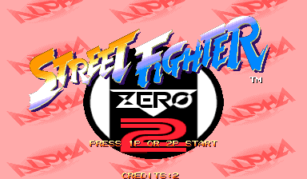
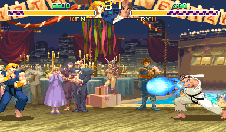
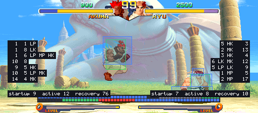

# Street Fighter Zero 2 Alpha Recomp

> Part of **[CPS-2 Recomp](../../README.md)**: one download and one launcher for every CPS-2 game this
> project has ported. This page is about Street Fighter Zero 2 Alpha; the [main page](../../README.md) says how to
> download and play.

An unofficial native PC port of the arcade game *Street Fighter Zero 2 Alpha* (Capcom, 1996, CPS-2 board) for
macOS, Linux (Steam Deck included) and Windows, made by static recompilation, with a full training mode.

Street Fighter Zero 2 Alpha is the later revision of Street Fighter Alpha 2 that came out in Asia, Japan and Brazil
(the console *Street Fighter Alpha 2 Gold* was made from it), and the version played online on Fightcade. It adds
**the EX forms of Ryu, Ken, Sagat and M. Bison** (their Champion Edition moves), Zangief's and Dhalsim's EX forms,
Evil Ryu, the classic Chun-Li and Shin Akuma, Custom Combos started with a punch and a kick of the same strength for
half the gauge, and other changes to the fight. It was made from Alpha 2's program: this port builds the same
sources as the [Street Fighter Alpha 2 port](../sfa2/README.md), with this game's own rules where they differ, so it
has everything that one has.

> **Beta.** The game plays from start to ending and its code is checked instruction by instruction, but nobody has
> played it by hand yet. Expect rough edges, and please [report what you find](#feedback-and-contributing).

**No game files are included.** You need your own copy of the game: the arcade ROM set `sfz2al` (Asia, 960826)
with its key file, from a board you own. **Only that version works.** This project cannot help you get one.

This project is not affiliated with, endorsed by, or sponsored by Capcom. *Street Fighter* is a trademark of Capcom
Co., Ltd.





## What it is

The game's 68000 program is translated ahead of time into C++ and compiled into the port. The routines that the
training mode and the other features touch (the hit tests, the guard decision, the damage formula, the throw, the
round's clock, the camera, reading the controls, pushing apart, the players' own state machine and the computer
player's scripts) are Alpha 2's readable rewrites, run here where this game has them, with this game's own rules
where they differ, and each is checked against this game's own code on every call ([how it works](PROGRESS.md)).
What the program expects of the board is code written for this project, not an emulator.

- Plays with a keyboard, a gamepad or an arcade stick; every key and button can be changed, for each player, in the
  launcher. Two more can be given a key or a button: all three punches at once, and all three kicks. In the collection
  it can have a layout of its own, apart from the other games'.
- An in-game menu (Esc or `F1`; on a gamepad, the left stick's click or Start and Select together)
  with the training mode and the other modes, save states, speed (1/8 to 8x), the cheats,
  every feature, and a Reset all options row.
- The picture your way (Display page): sharp, whole pixels or smooth; 4:3, square pixels or the
  whole screen; a shader; and the window's size.
- **Zoom**: hold the left stick's click and press the left shoulder to zoom in on player 1's fighter, the right
  shoulder for player 2's (keyboard: hold Left Shift and press Q or E). Each press for the same player goes a size
  up, 1.25x, 1.5x, 1.75x and 2x, then back to the whole picture; a press for the other player looks at that one
  instead. With the click (or Left Shift) still held, the d-pad or the stick moves the camera to frame it as you like.
  With the left stick's click held, the right stick's click (keyboard: Left Shift and W) keeps **both fighters** in
  the picture instead. The left stick's click alone still opens the menu, when it is let go.
- **Rapid fire** (Game page): a button held down is pressed again and again, fifteen times a second, for the first
  button or for all of them; the first press is seen at once.
- **Pure** plays exactly as the board does. **Enhanced** (the default) adds free play and your own
  character colours. Every other feature is a switch of its own.
- The board's operator settings (difficulty, damage level, timer speed, game speed, rounds and the rest) on the
  Board page, each as the board is set unless you choose; or the game's own test menu from the in-game menu. A new
  board's difficulty is Expert.
- **Straight to the title** (Game page): at a start or a reset, everything before the title runs unseen.
- **Arcade timing** (Game page, off unless chosen): the processor run as on the arcade board, so the game slows
  down where and as much as the board does. [More →](../../docs/TIMING.md)
- **A custom soundtrack**: your own music in place of the board's, with the board's sound effects and voices: a
  folder of music plays as a playlist (in order or shuffled), or files named for the game's songs replace those
  songs (the `songs.txt` the game writes names its 59 pieces: the board's sound program is Alpha 2's).
  [How →](../../docs/SOUNDTRACK.md)
- Your ROM set is only ever read. Settings, save states and the board's settings memory go in your own user folder,
  or beside the launcher in [portable mode](../../docs/LAUNCHER.md#portable-mode).

## The characters

Twenty-eight: Alpha 2's eighteen (Ryu, Ken, Akuma, Charlie, Chun-Li, Adon, Sodom, Guy, Birdie, Rose, M. Bison,
Sagat, Dan, Sakura, Rolento, Dhalsim, Zangief, Gen) and their other forms: the classic Chun-Li, Gen's other style,
Shin Akuma, Evil Ryu, and **the EX forms** of Zangief, Dhalsim, M. Bison, Sagat, Ken and Ryu. On the board the other
forms are chosen with Start held or pressed on the character. The **Hidden characters** switch (Game page) gives
them without the codes, for player 1, player 2 or both: choosing Ryu gives Evil Ryu, Akuma Shin Akuma, Chun-Li the
classic Chun-Li, and Ken, Sagat, M. Bison, Dhalsim and Zangief their EX forms; the alternative modes' fighters too.
Every one of the 28 is in the model viewer and the colour editor.

## Training mode

"Alternative modes" at the top of the in-game menu has a Training mode page: Start goes straight to the character
choice with two players (player 1's controls choose for both) and into a fight with no clock that nobody loses, and
the page holds the aids below.

| Feature | What it does |
| --- | --- |
| Hit boxes | The boxes the game itself tests: where a player can be hit (blue), attacks (red; orange for things thrown), pushing boxes (green) |
| Throw range | The zone in front of each player that the other's push box has to reach for a throw, as the game tests it |
| Frame data and frame meter | Startup, active and recovery of each move and the advantage after a hit or a guarded hit, counted in the game's own steps; a row of cells for each player, one a step; optionally every move written to `frame_data.csv` beside the settings |
| Input display | What each player presses and for how long, in numpad notation from the player's side |
| Combo readout | Hits and damage of a combo, the round's best |
| Custom Combo time | How long a Custom Combo has left |
| Stun readout | How much stun each player has taken, against how much stuns them |
| Fixed damage | No random part in a hit's damage (the average in its place), so a combo always does the same |
| Health refills | Health comes back when a player has not been hit for a moment |
| The dummy | Stands, crouches, jumps; guards (always, after a hit, at random; high or low by the game's own rule for each attack); Alpha counters while guarding; softens throws; quick rise after a knock-down; or played by the game's own computer player; records and replays in three slots (one, or any at random), and can answer with a recording after guarding or being hit |
| Start over | The round as it began, in the middle or a corner, sides swapped or not (Backspace, or a gamepad's left shoulder) |
| Stage | Any of the eighteen stages, or the game's own choice |
| Stop, step, slow | Stop the game, go on a frame at a time, or play at a half, a quarter or an eighth of the speed |

Also: save states in nine slots, free play, and cheats (no damage, one-hit knockouts, full gauge, infinite
time, no stun).



## Alternative modes

| Mode | What it does |
| --- | --- |
| Training mode | A fight with no clock that nobody loses, and the aids above |
| Attract mode | The game's own show on a loop: everything, the introduction only, or one demonstration fight after another |
| Stage viewer | Any of the eighteen stages with nobody on it and no panel, scrolled with the stick or by itself, with any tune; "Infinite" scrolls through every stage in turn |
| Model viewer | One character by itself (any of the 28), on a stage or on plain white or black, from a quarter of its size to 25 times, standing and moving with your controls or going through any of its animations, at full speed or in slow motion |
| Colour editor | Change a character's colours while you watch: custom colours, below |
| Survival | One computer opponent after another on the health you have left. How many can you beat? |
| Endless battle | Two fighters the game plays, for as long as you like, with no bars and no clock, on one stage, on stages that fade one into another, or on a floor that scrolls through them all. Touch the controls to take a fighter over. It is in the launcher's Multi game page too |
| Ring out | No health. Knock your opponent over the end of the stage, then jump down after it and land on the next stage. The CPU plays it as a ring out, not for damage: it throws or sweeps you when your back is to an end, and keeps off its own end |
| Tag team battle | Two teams of two or three, chosen on its page, one fighter of each team at a time: knock-out style (the one knocked down is out and the next comes on), or **tag style**, the default: Marvel-style, each fighter with a bar of its own, tagging the next one in with a gamepad's left trigger (or Start) whenever yours can act. Team 2 is the CPU, which tags too, as a person would, or player 2; with "Tag team" on, co-op or 2 vs 2 for four players |

## Widescreen

A switch on the launcher's first page, under "Full screen" (and on the in-game menu's Display page). Fights are
shown and played in 16:9: the picture is 512 columns wide where the board's is 384, at the same height and with
everything the same size, so there is a third more of the stage in view. Off unless you switch it on, because it
changes how the game plays (the players can stand further apart; the camera stops 64 short of where it did). The
bars, the clock and the gauges stay in the middle; the modes are wide too; everything that is not a fight keeps the
board's 4:3. The stages are Alpha 2's, painted to the camera's ends.

**Invisible walls** (Display page) keeps the 16:9 picture and plays the game exactly as the board does: the players
are stopped where the board's picture ends, by walls that are not seen.

## Custom colours

Give any character colours of your own, with the game's colour editor (on the in-game menu's "Alternative modes"
page: the character in front of you, any of their six colour sets, 16 levels each of red, green and blue, random
colours, a library of saved sets) or with [PalMod](https://github.com/Preppy/PalMod): edit a copy of your set's
`szaa.07` with it (never the one in your ROM set) and put the copy in the `palettes` folder (not tried with PalMod
itself yet). To play in them, choose the character with the button of the set you changed. It works as in Alpha 2,
whose page has the [whole story](../sfa2/README.md#custom-colours); the folder is:

| System | Folder |
| --- | --- |
| Windows | `%APPDATA%\Street Fighter Zero 2 Alpha\palettes` |
| macOS | `~/Library/Application Support/Street Fighter Zero 2 Alpha/palettes` |
| Linux, SteamOS | `~/.local/share/Street Fighter Zero 2 Alpha/palettes` |
| [Portable mode](../../docs/LAUNCHER.md#portable-mode) | `user/Street Fighter Zero 2 Alpha/palettes` beside the launcher |

## What you need

- The ROM set `sfz2al` (*Street Fighter Zero 2 Alpha*, Asia 960826): `sfz2al.zip` or a folder with the set's files,
  including `sfz2al.key`. The launcher checks every file by checksum and tells you which is missing or different.
  Sets of other regions and revisions are refused: the port is made from this one version's program.
- One of: macOS 13 or later (Apple silicon or Intel); Linux x86_64 or SteamOS; Windows 10 or 11, 64-bit.
- A gamepad or stick with six buttons is recommended.

## Playing

Street Fighter Zero 2 Alpha comes with [CPS-2 Recomp](../../README.md#getting-started): open its launcher and show it your
ROM set (drop `sfz2al.zip` or its folder on the window, or choose the folder you keep your sets in), then press
**Play** beside Street Fighter Zero 2 Alpha. From a terminal, `cps2recomp-launcher --play sfz2al` starts it straight
away; the game's own program (`sfz2al`, beside the launcher) runs by itself too: `sfz2al --help` lists what it takes.

## Building from source

With your own ROM set in `rom/sfz2al/` (ignored by Git), from the repository's top:

```sh
make GAME=sfz2al            # twice the first time
make GAME=sfz2al explore    # once: finds the game's code by made-up play and translates it
make GAME=sfz2al run
make GAME=sfz2al check-rewrites check-widescreen
```

The sources are Alpha 2's (`games/sfa2/src`); `family.h` here says where their places are in this game and what is
its own, and [PROGRESS.md](PROGRESS.md) what was found. [docs/BUILDING.md](../../docs/BUILDING.md) has every
platform.

## Feedback and contributing

Bug reports and pull requests are welcome: see [CONTRIBUTING.md](../../CONTRIBUTING.md) for the rules (above all:
nothing from the game, ever).

## License and credits

GPL-3.0-only (see [LICENSE](../../LICENSE)); [THIRD_PARTY_NOTICES.md](../../THIRD_PARTY_NOTICES.md) lists what comes
from other projects. The repository holds no game data: the places `family.h` lists are numbers, as the names
headers' are.
