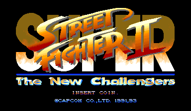
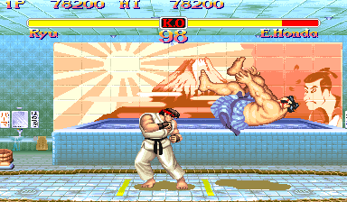

# Super Street Fighter II Recomp

> Part of **[CPS-2 Recomp](../../README.md)**: one download and one launcher for every CPS-2 game this
> project has ported. This page is about Super Street Fighter II; the [main page](../../README.md) says how to
> download and play.

An unofficial native PC port of the arcade game *Super Street Fighter II: The New Challengers* (Capcom, 1993, CPS-2
board) for macOS, Linux (Steam Deck included) and Windows, made by static recompilation.

Super Street Fighter II is the first game on the CPS-2 board: the four new challengers (Cammy, T. Hawk, Fei Long, Dee
Jay), new colours, the redrawn stages, the arranged music. Capcom made Super Turbo from its program, and this port builds
the same sources as the [Super Street Fighter II Turbo port](../ssf2t/README.md), with this game's own places, so it
has what that one has but what Super Turbo added to the game (super combos, Akuma and the old versions, the speeds).

It has a full **training mode** (hit boxes, frame data and a frame meter, input display, combo and stun readouts, a
dummy that records, replays and guards), the **alternative modes** (attract mode, the stage and model viewers,
survival, endless battle, ring out, a tag team battle), **widescreen**, **custom colours** with a colour editor, and
the features every game shares: free play, straight to the title, the board's operator settings, cheats, save states,
run-ahead, arcade timing, a custom soundtrack.

> **Beta.** The game plays from start to ending and its code is checked instruction by instruction, but nobody has
> played it by hand yet. Expect rough edges, and please [report what you find](#feedback-and-contributing).

**No game files are included.** You need your own copy of the game: the arcade ROM set `ssf2` (World, 931005) with its
key file, from a board you own. **Only the sets named below work.** This project cannot help you get one.

This project is not affiliated with, endorsed by, or sponsored by Capcom. *Street Fighter* is a trademark of Capcom
Co., Ltd.





## What it is

The game's 68000 program is translated ahead of time into C++ and compiled into the port, and so is its sound CPU's
(Capcom's sound driver 1.04). Everything the port adds is Super Turbo's sources, which name the places they use in
Super Turbo's program; this game's `family.h` says where each is here ([how it was made](PROGRESS.md)). What the
program expects of the board is code written for this project, not an emulator.

Training mode, the alternative modes, widescreen and its invisible walls, the colour editor, the zoom, the in-game
menu and the rest work as on the [Super Turbo page](../ssf2t/README.md), with these differences:

- No super combo gauge (so no gauge refill in training), no hidden characters, and no game speed on the Board page:
  the game has none of them.
- **Custom colours**: each character has eight sets (the six buttons, Start, a button held) of one to eight palettes
  (one for most, three for Ryu, Guile, Ken, Chun-Li, Sagat and Dee Jay, eight for M. Bison). PalMod's file for it is
  `ssfe.04`.
- **Other games' stages**: as in Super Turbo, the training mode, the viewers and the battles can be fought on the
  other fighting games' stages (their sets needed beside this one's).
- **A custom soundtrack**: [the list of its songs](../../docs/SONGS.md#super-street-fighter-ii) names the music:
  Super Turbo's, but its own title and player select, the bonus stages' tune, and no final fight's (M. Bison's stage
  plays). [How →](../../docs/SOUNDTRACK.md)

## The board's settings

The Board page has the settings of the test menu's System Configuration that change the game, each "As the board is
set" unless chosen. A choice is what the test menu would have set; the board's settings memory itself is not changed.

| Setting | Choices | The board's own (a new board) |
| --- | --- | --- |
| Difficulty | 1 (easiest) to 8 (hardest) | 4 (medium) |
| Continue | Off, On | On |
| Demo sound | Off, On | Off |

## What you need

- The ROM set `ssf2` (*Super Street Fighter II: The New Challengers*, World 931005): `ssf2.zip` or a folder with the
  set's files, including `ssf2.key`. The launcher checks every file by checksum and tells you which is missing or
  different. Other revisions are refused: the port is made from this program.
- One of: macOS 13 or later (Apple silicon or Intel); Linux x86_64 or SteamOS; Windows 10 or 11, 64-bit.
- A gamepad or stick with six buttons is recommended.

## Playing

Super Street Fighter II comes with [CPS-2 Recomp](../../README.md#getting-started): open its launcher and show it your
ROM set, then press **Play** beside Super Street Fighter II. From a terminal, `cps2recomp-launcher --play ssf2` starts
it straight away.

## Building from source

With your own ROM sets in `rom/ssf2/` and `rom/ssf2t/` (ignored by Git; Super Turbo's is needed only to make
`family.h` again), CMake, Ninja, SDL 3 and Python 3, from the repository's top:

```sh
make GAME=ssf2            # twice the first time
make GAME=ssf2 explore    # once: finds the game's code by made-up play and translates it
make GAME=ssf2 run
make GAME=ssf2 check FRAMES=55000 MOVIE=games/ssf2/movies/ladder.txt ARGS="--features free_play,no_damage,one_hit"
```

[docs/BUILDING.md](../../docs/BUILDING.md) has every platform, the checks and the release builds, and
[PROGRESS.md](PROGRESS.md) what was found about the game and what is next.

## Feedback and contributing

Bug reports and pull requests are welcome: see [CONTRIBUTING.md](../../CONTRIBUTING.md) for the rules (above all:
nothing from the game, ever).

## License and credits

GPL-3.0-only (see [LICENSE](../../LICENSE)); [THIRD_PARTY_NOTICES.md](../../THIRD_PARTY_NOTICES.md) lists what comes
from other projects. The repository holds no game data and nothing derived from it.
