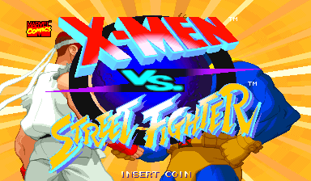
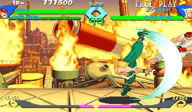
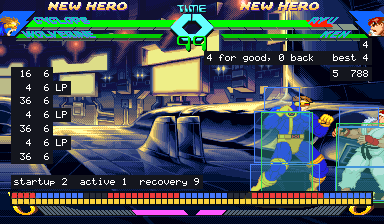
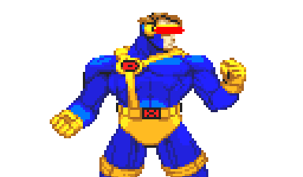
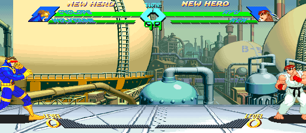

# X-Men vs. Street Fighter Recomp

> Part of **[CPS-2 Recomp](../../README.md)**: one download and one launcher for every CPS-2 game this
> project has ported. This page is about X-Men vs. Street Fighter; the [main page](../../README.md) says how to
> download and play.

An unofficial native PC port of the arcade game *X-Men vs. Street Fighter* (Capcom, 1996, CPS-2 board) for macOS,
Linux (Steam Deck included) and Windows, made by static recompilation. It is the first tag-team game here: each side
is a team of two characters, swapped in and out during the fight.

It has everything the other fighting games here have: a full **training mode** (hit boxes, frame data and a frame
meter, input display, combo readout, a dummy that records, replays and guards), the **alternative modes** (attract
mode, the stage and model viewers, survival, endless battle, ring out), **tag-team co-op and 2 vs 2** for up to four
players, **widescreen**, **custom colours** with a colour editor, the **hidden character** with no code, and the features every game shares: free play, straight to the
title, the board's operator settings, cheats, save states, run-ahead, arcade timing, a custom soundtrack.

> **Beta.** The game plays from start to ending and its code is checked instruction by instruction, but it has
> been played on few machines and controllers yet. Expect rough edges, and please
> [report what you find](#feedback-and-contributing).

**No game files are included.** You need your own copy of the game: the arcade ROM set `xmvsf` (Europe, 961004)
with its key file, from a board you own. **Only that version works.** This project cannot help you get one.

This project is not affiliated with, endorsed by, or sponsored by Capcom or Marvel. *Street Fighter* is a trademark
of Capcom Co., Ltd.; *X-Men* and its characters are trademarks of Marvel Characters, Inc.







## What it is

The game's 68000 program is translated ahead of time into C++ and compiled into the port, and so is its sound
CPU's (Capcom's sound driver 1.16b). What the program expects of the board (its video, the QSound chip, the sound CPU
and its registers, the settings memory) is code written for this project, not an emulator. Every translated block
is checked against an interpreter of the same program ([how it was made](PROGRESS.md)).

- Plays with a keyboard, a gamepad or an arcade stick; every key and button can be changed, for each player, in the
  launcher. The game has six buttons: three punches and three kicks (a strong punch and a strong kick together tag the
  partner in). Two more can be given a key or a button: all three punches at once, and all three kicks. In the
  collection it can have a layout of its own, apart from the other games'.
- An in-game menu (Esc or `F1`; on a gamepad, the left stick's click or Start and Select together) with the
  training mode and the other modes, save states, speed (1/8 to 8x), the cheats,
  every feature, and a Reset all options row.
- **Zoom**: hold the left stick's click and press the left shoulder to zoom in on player 1's fighter, the right
  shoulder for player 2's (keyboard: hold Left Shift and press Q or E). Each press for the same player goes a size
  up, 1.25x, 1.5x, 1.75x and 2x (the model viewer's sizes: at 2x the top of a tall fighter is off the screen), then
  back to the whole picture; a press for the other player looks at that one instead. The fighter is kept in the
  middle all the while (past the stage's ends is black); with the click (or Left Shift) still held, the d-pad or
  the stick (the arrows) moves the camera to frame it as you like, until the zoom is off or looks at the other fighter. The size eases from one
  to the next, it is said at the bottom for a few seconds, and outside a fight the picture is whole again. The
  game's own health bars are zoomed with it; the port's own text (a mode's score, the training display) is not.
  With the left stick's click held, the right stick's click (keyboard: Left Shift and W) keeps **both fighters** in
  the picture instead: the camera as close as shows both whole, tight when they are close and wide when they are
  apart (2x at most, the whole picture at least), kept inside the stage; again for the whole picture. The left
  stick's click alone still opens the menu, when it is let go.
- **Rapid fire** (Game page): a button held down is pressed again and again, fifteen times a second, for the first
  button or for all of them; the first press is seen at once.
- **Pure** plays exactly as the board does. **Enhanced** (the default) adds free play (the game's own, one of the
  board's coin settings) and your own [character colours](#custom-colours). Every other feature is a switch of its
  own.
- **Straight to the title** (Game page): at a start or a reset, everything before the title (the board's start,
  the warning, the notices and the introduction) runs unseen; with a coin in, the picture comes back with the title
  that asks for Start.
- The board's operator settings (difficulty, damage level, timer speed, game speed and the rest) on the Board page
  (launcher's Features, in-game menu), each as the board is set unless you choose; or the game's own test menu from
  the in-game menu.
- Cheats: no damage (each player's team), one-hit knockouts, infinite time.
- **Hidden character** (Game page): Akuma with no code. Hold Start as you choose Ryu. (Start held as you choose
  Chun-Li gives her *Street Fighter Alpha* look, as on the board.)
- **Arcade timing** (Game page, off unless chosen): the processor run as on the arcade board, so the game slows
  down where and as much as the board does. [More →](../../docs/TIMING.md)
- **Run-ahead** (Game page): what you press seen a frame or two sooner than on the board, with the game running
  exactly as without it.
- **A custom soundtrack**: your own music in place of the board's, with the board's sound effects and voices: a
  folder of music plays as a playlist (in order or shuffled), or files named for the game's songs replace those
  songs. The `songs.txt` the game writes in the soundtrack folder names the music: each character's theme (a round
  plays player 2's), player select, the screen before each stage, the winner's, the warning before Apocalypse, the
  ending, the staff roll, game over and the notices. [How →](../../README.md#a-custom-soundtrack)
- Your ROM set is only ever read. Settings, save states and the board's settings memory go in your own user folder, or beside the launcher in [portable mode](../../README.md#portable-mode).

## Training mode

"Alternative modes" at the top of the in-game menu has a Training mode page: Start goes straight to the character
choice with two players (player 1's controls choose for both: two characters each, then the mode and the speed) and
into a fight with no clock that nobody loses, and the page holds the aids below. The aids follow the character on
point; the one resting is refilled with it.

| Feature | What it does |
| --- | --- |
| Hit boxes | The boxes the game itself tests: where a character can be hit (blue), attacks (red; orange for things thrown), how near a throw reaches (yellow outline), pushing boxes (green) |
| Frame data and frame meter | Startup, active and recovery of each move and the advantage after a hit or a guarded hit, counted in the game's own steps; a row of cells for each player, one a step; optionally every move written to `frame_data.csv` beside the settings |
| Input display | What each player presses and for how long, in numpad notation from the player's side |
| Combo readout | Hits and damage of a combo, how much of it comes back while the character rests, the round's best |
| Health and gauge refills | Health comes back when a player has not been hit for a moment (the partner's too); both hyper combo gauges kept full |
| The dummy | Stands, crouches, jumps; guards (always, after a hit, at random); records and replays in three slots (one, or any at random), and can answer with a recording after guarding or being hit |
| Start over | The round as it began, in the middle or a corner, sides swapped or not (Backspace, or a gamepad's left shoulder) |
| Stage | Any of the eleven stages, or the game's own choice |
| Stop, step, slow | Stop the game, go on a frame at a time, or play at a half, a quarter or an eighth of the speed |

## Alternative modes

The in-game menu's first row, "Alternative modes", has ways of playing and watching the game that the board does not
have. Each has a page with a Start row and its own choices, and runs until another is started or the menu's Reset game.

| Mode | What it does |
| --- | --- |
| Training mode | A fight with no clock that nobody loses, and the aids above |
| Attract mode | The game's own show on a loop: everything, the introduction only, or the demonstration fight after the title over and over |
| Stage viewer | Any of the eleven stages with nobody on it and no panel, scrolled with the stick or by itself; "Infinite" scrolls through every stage in turn |
| Model viewer | One character by itself, on a stage or on plain white or black, from a quarter of its size to 25 times. It stands and moves with your controls, or goes through any of its animations (named A0, B12, C3... by the game's own groups of them; left and right step through them), over and over or all of them one after another (Play all), at full speed or in slow motion |
| Colour editor | Change a character's colours while you watch: [custom colours](#custom-colours) |
| Survival | One computer team after another on the health you have left. How many can you beat? |
| Endless battle | Two teams the game plays, for as long as you like, with no bars and no clock, on one stage, on stages that fade one into another, or on a floor that scrolls through them all. Touch the controls to take a side over |
| Ring out | No health. Knock your opponent over the end of the stage (it is flung into the air and falls through the floor), then jump down after it and land on the next stage |

## Tag team: co-op and 2 vs 2

Each character of a team can be played by a person of its own, with no patched ROM: "Tag team" on the Alternative
modes page (or the launcher's Features page) chooses how.

| Choice | Who plays |
| --- | --- |
| Off | One player a side, as on the board |
| Co-op vs. computer | Players 1 and 2 are one team against the computer. Either one's Start begins the game on player 1's side; nobody can come in on the computer's side |
| 2 vs 2 | Four players: 1 and 3 are one team, 2 and 4 the other. Either person of a team can Start (or continue) for it |

- **Choosing**: the team's first character is chosen by its first person (player 1 or 2), the second by its partner
  (player 2 in co-op, else 3 or 4). Only the person choosing moves the cursor; the first person chooses the speed.
- **Fighting**: the controls are whoever plays the character on point. The partner tags in by pressing a strong
  punch and a strong kick together; the one on point can still tag out the same way, and team supers work as on the
  board. A knock-out, a tag or a team super changes who is on point exactly when the game does.
- A small label under each side's bars (P1-P4) says who is on point.
- The launcher's Controllers page has keys and buttons for four players.



## Widescreen



A switch on the launcher's first page, under "Full screen" (and on the in-game menu's Display page). Fights are shown
and played in 16:9: the picture is 512 columns wide where the board's is 384, at the same height and with everything
the same size, so there is a third more of the stage in view.

It is **off unless you switch it on**, in every preset, because it changes how the game plays:

- The characters can go to the wide picture's edges, so they can stand further apart than on the board. The stage's
  own ends are where they were.
- The camera stops 64 short of where it did, so that the picture ends where the stage does.
- The bars and the gauges stay in the middle. Everything that is not a fight keeps the board's 4:3.

With it off the game is exactly the board's. Nothing here stretches the picture: the extra columns are the game's own
stage art, which the board already holds and never showed, and on all eleven stages they are painted to the camera's
ends.

**Invisible walls**, on the Display page, keeps the 16:9 picture and plays the game exactly as the board does: the
characters are stopped where the board's picture ends, by walls that are not seen, and the camera goes as far as the
board's. Near a stage's end the view stays on the stage, so the play area is then to one side of the wide picture. The
game's memory is the same as with widescreen off, frame for frame (`make GAME=xmvsf check-widescreen` compares it
along the ladder).

## Custom colours

Give any character colours of your own: change them in the game's colour editor (Alternative modes), or bring files
someone else made.

- **The colour editor** shows the character with a panel at the right, worked with player 1's controls: the
  character, background, size and animation; the **set** (by the button that chooses the character: a punch (P) or a
  kick (K)); the **line** (the character's own colours, or one of two lines for its effects); each colour's red,
  green and blue; random colours; saving a set to the character's library and loading it into any set. Changes show
  at once and are saved as you go. To play in them, choose the character with the button of the set you changed.
- **Files**: `palettes/<Character>.txt` in the game's data folder (one section a set, a line of 16 colours a
  palette), or an `xvs.05a` changed with PalMod. "Write the game's colours" writes the game's own to start from.

## The board's settings

The Board page has nine settings of the test menu's Configuration, each "As the board is set" unless chosen.
A choice is what the test menu would have set; the board's settings memory itself is not changed, and the test
menu shows the board's own values.

| Setting | Choices | The board's own (a new board) |
| --- | --- | --- |
| Difficulty | Easy, Normal, Hard 1 to 5, Expert | Normal |
| Damage level | Low, Normal, High, Maximum | Normal |
| Timer speed | Slow, Normal, Fast, Fastest | Normal |
| Game speed | Normal, Turbo 1, Turbo 2, Free select 1, Free select 2 | Free select 2 |
| Automatic | Off, Free select (players may choose the automatic guard) | Off |
| Event | Off, one match (and no continue) | Off |
| Join-in | Off, On (a second player can join a game against the computer) | On |
| Continue | Off, On | On |
| Demo sound | Off, On | On |

## What you need

- The ROM set `xmvsf` (*X-Men Vs. Street Fighter*, Europe 961004): `xmvsf.zip` or a folder with the set's files,
  including `xmvsf.key`. The launcher checks every file by checksum and tells you which is missing or different.
  Sets of other regions and revisions are refused: the port is made from this one version's program, and its
  features use addresses found in it.
- One of: macOS 13 or later (Apple silicon or Intel); Linux x86_64 or SteamOS; Windows 10 or 11, 64-bit.
- A gamepad or stick with six buttons is recommended (and one more for Start, for the hidden character).

## Playing

X-Men vs. Street Fighter comes with [CPS-2 Recomp](../../README.md#playing): open its launcher and show it your ROM
set (drop `xmvsf.zip` or its folder on the window, or choose the folder you keep your sets in), then press **Play**
beside X-Men vs. Street Fighter. From a terminal, `cps2recomp-launcher --play xmvsf` starts it straight away; the
game's own program (`xmvsf`, beside the launcher) runs by itself too: `xmvsf --help` lists what it takes.

While playing, Esc or `F1` (on a gamepad, the left stick's click, or Start and Select together) opens the in-game
menu. Only the menu's "Quit game" row (or closing the window) ends the game.

## Building from source

With your own ROM set in `rom/xmvsf/` (ignored by Git), CMake, Ninja, SDL 3 and Python 3, from the repository's top:

```sh
make GAME=xmvsf            # twice the first time
make GAME=xmvsf explore    # once, about five minutes: finds the game's code by made-up play and translates it
make GAME=xmvsf run
make GAME=xmvsf check FRAMES=40000 MOVIE=games/xmvsf/movies/ladder.txt
```

[docs/BUILDING.md](../../docs/BUILDING.md) has every platform, the checks and the release builds, and
[PROGRESS.md](PROGRESS.md) what was found about the game and what is next.

## Feedback and contributing

Bug reports and pull requests are welcome: see [CONTRIBUTING.md](../../CONTRIBUTING.md) for the rules (above all:
nothing from the game, ever).

## License and credits

GPL-3.0-only (see [LICENSE](../../LICENSE)); [THIRD_PARTY_NOTICES.md](../../THIRD_PARTY_NOTICES.md) lists what comes
from other projects. The repository holds no game data and nothing derived from it. Facts about the game's memory
were confirmed with the help of the FBNeo training mode's scripts for this set (peon2/fbneo-training-mode), each
checked again here.
